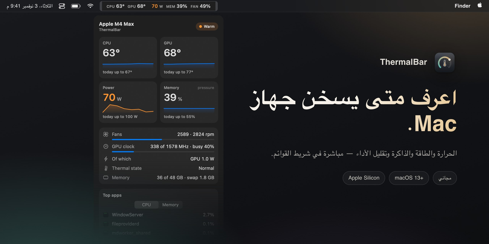

<div align="center">

<a href="https://github.com/evilork/thermalbar/releases/latest"></a>

[English](README.md) · [Русский](README.ru.md) · [简体中文](README.zh-CN.md) · [Español](README.es.md) · [Türkçe](README.tr.md) · **العربية** · [日本語](README.ja.md) · [Deutsch](README.de.md) · [Français](README.fr.md) · [한국어](README.ko.md)

<h3>اعرف متى يسخن جهاز Mac.</h3>

<div dir="rtl">

تطبيق مجاني لشريط القوائم على أجهزة Mac بمعالجات Apple Silicon. حرارة المعالج وبطاقة الرسومات، والطاقة، وضغط الذاكرة، والمراوح، وتقليل الأداء (throttling) — مباشرة، بألوان واضحة، وبنظرة واحدة.

</div>

<a href="https://github.com/evilork/thermalbar/releases/latest/download/ThermalBar.zip"></a>

<sub>مجاني · macOS 13 Ventura أو أحدث · Apple Silicon M1–M5 · موقّع وموثّق من Apple</sub>

<br>

[](https://github.com/evilork/thermalbar/releases)
[](https://github.com/evilork/thermalbar/stargazers)
[](https://github.com/evilork/thermalbar/releases/latest)
[](#التثبيت)

</div>

<div dir="rtl">

---

## لماذا ThermalBar

لا يخبرك جهاز Mac حين ترتفع حرارته. هو ببساطة يصبح أبطأ: يخفض macOS التردداتِ بصمت، وتدور المراوح بسرعة أكبر، وتنخفض سلاسة اللعبة، ويستغرق التصدير وقتًا أطول. يضع ThermalBar الأرقام حيث تراها دائمًا، ويخبرك بوضوح حين يكون هناك خلل.

- **نظرة واحدة.** تبقى الأرقام هادئة ما دام كل شيء بخير، ثم تتحول إلى البرتقالي ثم الأحمر كلما ارتفعت.
- **يخبرك بالسبب.** ترى اللحظة التي تبدأ فيها الحرارة بإبطاء الـ Mac، ومتى تعلق بطاقة الرسومات عند تردد منخفض.
- **أصلي وخفيف.** تطبيق واحد صغير. بلا Homebrew، وبلا عملية مساعدة، وبلا `sudo`، وبلا Electron، وبلا شبكة.

## كل شيء بنقرة واحدة

<p align="center"></p>

انقر على الأرقام في شريط القوائم لتفتح اللوحة: درجات الحرارة مع اتجاه آخر خمس دقائق، وقمم اليوم، والطاقة، وضغط الذاكرة والتبديل (swap)، والمراوح، وتردد بطاقة الرسومات وحمّلها، وأكثر ثلاثة تطبيقات تحمّل جهازك، وآخر جلسة لعب لك. اللوحة زجاجية مع شريط لضبط الشفافية، وتتبع الوضع الفاتح والداكن.

## تقليل الأداء، وبطاقة رسومات عالقة، وذاكرة تنفد

- **مؤشر تقليل الأداء.** تظهر علامة صغيرة في شريط القوائم عندما يخفض macOS الترددات بسبب الحرارة، مع تلميح إلى ما قد يساعد.
- **«بطاقة الرسومات عالقة عند تردد منخفض».** إذا كانت بطاقة الرسومات مشغولة تمامًا لكنها تعمل بجزء صغير من أعلى تردد لها ولا تفسّر الحرارة ذلك، يخبرك ThermalBar. وعادةً تحل إعادة التشغيل المشكلة.
- **ضغط الذاكرة كما يراه macOS.** لا «نسبة RAM» المضللة، بل التقييم نفسه بالأخضر والأصفر والأحمر الذي يستخدمه «مراقب النشاط»، إضافةً إلى التبديل (swap).
- **إشعارات** لكل حالة من هذه، مرة واحدة كل 20 دقيقة على الأكثر. ويمكن إيقاف كل منها.

## إحصاءات يمكنك تصديرها

<p align="center"></p>

يحتفظ ThermalBar على جهازك بسجل دقيقة بدقيقة لمدة 90 يومًا. اختر اليوم أو 7 أيام أو 30 يومًا أو أي تواريخ، واحفظ تقريرًا أنيقًا برسوم بيانية (HTML، يُفتح في أي متصفح) أو جدول بيانات (CSV لبرنامجي Excel وNumbers). تُكتشف جلسات اللعب تلقائيًا، فترى كم ارتفعت الحرارة فعلًا في آخر أمسية لعب.

## إعدادات، لا ملفات ضبط

<p align="center"></p>

اختر ما يعرضه شريط القوائم، سطرًا واحدًا أو سطرين، والتسميات والألوان. تبدأ الحدود بقيم معقولة لشريحتك (الأساسية أو Pro أو Max أو Ultra) ولك أن تغيّرها. الإنجليزية والروسية، وتُختار حسب لغة النظام.

## التثبيت

1. نزّل **[ThermalBar.zip](https://github.com/evilork/thermalbar/releases/latest/download/ThermalBar.zip)**.
2. فك الضغط واسحب **ThermalBar.app** إلى **التطبيقات**.
3. افتحه. التطبيق موقّع وموثّق من Apple، لذا يُفتح دون تحذيرات.

أو ثبّته عبر [Homebrew](https://brew.sh):

```sh
brew install --cask evilork/tap/thermalbar
```

يُفتح ThermalBar عند تسجيل الدخول افتراضيًا؛ يمكنك إيقاف ذلك من **الإعدادات ← عام (Settings → General)**.

**هل تحدّث من الإصدار 1.0؟** أغلق التطبيق القديم واستبدله بالجديد. يوقف الإصدار 2.0 أداة `macmon` المساعدة القديمة تلقائيًا. تبقى `macmon` مثبّتة؛ احذفها بالأمر `brew uninstall macmon` إن لم يكن هناك ما يستخدمها.

**المتطلبات:** جهاز Mac بمعالج Apple Silicon (M1 أو أحدث) ونظام macOS 13 Ventura أو أحدث.

## الخصوصية

يقرأ ThermalBar الحساسات فقط. لا يغيّر أبدًا سرعات المراوح ولا الترددات ولا إعدادات النظام، ولا يرسل أي طلبات عبر الشبكة، ولا يغادر جهازك أي شيء. يبقى سجل الإحصاءات في `~/Library/Application Support/ThermalBar`.

## الحدود الافتراضية

| المقياس | برتقالي | أحمر | الشارة |
|---------|---------|------|--------|
| حرارة المعالج وبطاقة الرسومات | 70 °C | 85 °C | 95 °C |
| الطاقة، الشرائح الأساسية | 15 W | 30 W | 45 W |
| الطاقة، شرائح Pro | 40 W | 70 W | 90 W |
| الطاقة، شرائح Max | 60 W | 100 W | 130 W |
| الطاقة، شرائح Ultra | 90 W | 150 W | 200 W |
| المراوح (نسبة من أعلى سرعة) | 70% | 90% | — |
| الذاكرة | أصفر macOS | — | أحمر macOS |

## أيّ أداة مراقبة تختار؟

يؤدي ThermalBar مهمة واحدة: مراقبة الحرارة. يجيب عن سؤالين: «هل جهاز Mac ساخن أكثر من اللازم؟» و«هل يبطئه ذلك؟»

- **اختر ThermalBar** إن أردت الحرارة والطاقة وضغط الذاكرة والمراوح وتقليل الأداء بكلمات واضحة، مع تنبيهات وسجل يمكنك تصديره.
- **اختر Stats أو iStat Menus** إن أردت أيضًا الشبكة والقرص والبطارية ورسومًا لكل نواة في شريط القوائم. Stats مجاني ومفتوح المصدر، وiStat Menus مدفوع؛ وكلاهما يغطي نطاقًا أوسع بكثير.
- **اختر تطبيقًا للتحكم في المراوح** إن أردت ضبط سرعتها بنفسك. ThermalBar يقرأ المستشعرات فقط ولا يغيّر شيئًا.

## الأسئلة الشائعة

**كيف أعرف حرارة المعالج على Mac؟** لا يعرضها macOS في أي مكان. ثبّت ThermalBar فتظهر حرارة المعالج وبطاقة الرسومات في شريط القوائم فورًا، دون كلمة مرور المسؤول ودون Terminal.

**ما الحرارة الطبيعية لجهاز Mac بشريحة Apple Silicon؟** لا تنشر Apple حدًا معيّنًا. تحت الحمل الثقيل كثيرًا ما تعمل الشرائح بين 80 و100 °C، خاصةً في طرازات MacBook Air بلا مروحة، ويحمي macOS الشريحة بخفض تردداتها. لذلك السؤال المفيد هو: هل يقلّل الجهاز أداءه؟ وهذا بالضبط ما يعرضه ThermalBar.

**هل يحتاج إلى sudo أو كلمة مرور المسؤول؟** لا. ليس لدى ThermalBar عملية مساعدة ولا يطلب كلمة مرور؛ فهو يقرأ المستشعرات نفسها التي يقرؤها macOS لنفسه.

**هل يُبطئ ThermalBar جهاز Mac؟** لا. وفق قياساتنا، عندما تكون اللوحة مغلقة يستهلك نحو 1% من نواة معالج واحدة ونحو 100 ميغابايت من الذاكرة. ولا تُرسم اللوحة إلا وهي مفتوحة.

**هل هو مجاني؟** نعم.

**هل يعمل على أجهزة Mac بمعالجات Intel؟** لا. تعمل الحساسات بطريقة مختلفة في Intel؛ ThermalBar مصنوع لـ Apple Silicon.

**لماذا ليس في Mac App Store؟** لأنه يقرأ الحساسات عبر واجهات نظام للقراءة فقط لا يُسمح لتطبيقات App Store باستخدامها.

**هل حرارة بطاقة الرسومات حقيقية؟** لا يوجد في Apple Silicon حساس واحد لبطاقة الرسومات. يأخذ ThermalBar متوسط الحساسات في جزء الرسومات من الشريحة، وهذا يطابق ما تعرضه أدوات المراقبة الأخرى.

**هل هو مفتوح المصدر؟** كان الإصدار 1.0 كذلك. ابتداءً من 2.0 أصبح الكود المصدري مغلقًا؛ ويبقى التطبيق مجانيًا.

**كيف أحذفه؟** أوقف **فتح عند تسجيل الدخول (Open at login)** في الإعدادات، وأنهِ ThermalBar، ثم اسحبه إلى سلة المحذوفات. ولحذف الإعدادات والسجل أيضًا، احذف `~/.config/thermalbar` و`~/Library/Application Support/ThermalBar`.

## الدعم

ThermalBar مجاني. إن استحق مكانًا في شريط القوائم لديك، فإن أي إكرامية ستكون موضع تقدير كبير.

| العملة | العنوان |
|--------|---------|
| **BTC** | `bc1pd47ssznzl6afr94zdkyk3g504h4l5m9etfg83lnwlsradg7yrrysk2wlt7` |
| **LTC** | `M9hXcyfRfaXajtzNbVV6pJwC5RoFbijfys` |
| **ETH** | `0x6e5afc8583239da03bf3fd21dd7fafe5e65e1670` |
| **SOL** | `FZ6jUxZUpzneTGgv4X7KAXmxjLrVAfksBojnw6mkEuqQ` |
| **TRON** | `TNHjSq6kc4bmt7tX5QGxd1YsGFa2XN62uQ` |
| **TON** | `UQCCFCDL7fDf6WTcEtAluxL9oAN8sKb3awjH7U752Xkzl1XI` |

وجدت خطأً أو لديك فكرة؟ [افتح بلاغًا](https://github.com/evilork/thermalbar/issues).

---

<div align="center">

**إن كان ThermalBar مفيدًا لك، فضع نجمة ⭐ للمستودع — فهذا يساعد مستخدمي Mac الآخرين على العثور عليه.**

</div>

<details>
<summary><sub>الكلمات المفتاحية</sub></summary>

<sub>

ThermalBar **مراقب حرارة Mac** مجاني ومراقب نظام **macOS** خفيف في **شريط القوائم**: مراقب حرارة ماك · حرارة معالج ماك · حرارة ماك بوك · حرارة كرت الشاشة ماك · برنامج مجاني لقياس حرارة الماك · عرض الحرارة في شريط القوائم ماك · مراقب نظام ماك مجاني · **بديل iStat Menus مجاني** · ارتفاع حرارة الماك بوك · كيف أعرف حرارة المعالج في الماك · سخونة الماك بوك · تقليل أداء الماك بسبب الحرارة · سرعة مراوح ماك · ضغط الذاكرة ماك · استهلاك الطاقة بالواط ماك · حرارة Apple Silicon · حرارة M1 M2 M3 M4 M5 · حرارة M4 Max · mac temperature monitor · cpu temperature mac · istat menus alternative free · mac throttling monitor · apple silicon temperature monitor

بديل مجاني وأصلي لتطبيقات **iStat Menus** و**Stats** و**Fanny** و**Hot**، يركّز على الحرارة والطاقة وضغط الذاكرة والمراوح وتقليل الأداء.

</sub>

</details>

</div>
