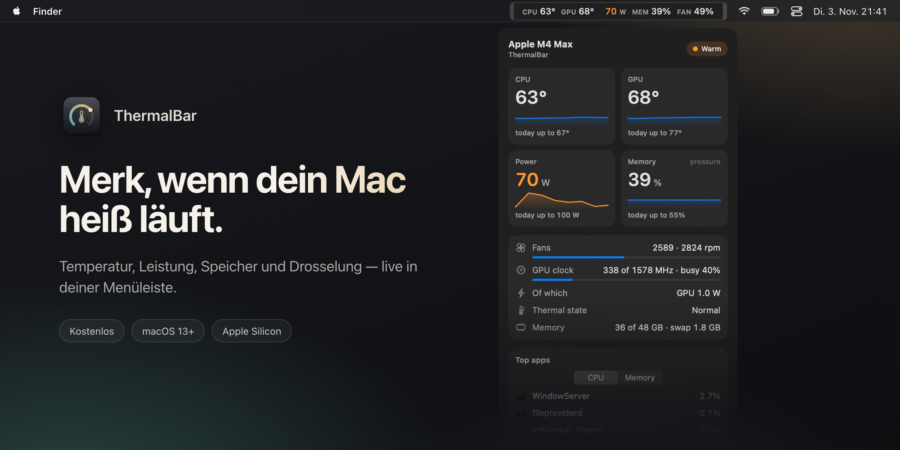

<div align="center">

<a href="https://github.com/evilork/thermalbar/releases/latest"></a>

[English](README.md) · [Русский](README.ru.md) · [简体中文](README.zh-CN.md) · [Español](README.es.md) · [Türkçe](README.tr.md) · [العربية](README.ar.md) · [日本語](README.ja.md) · **Deutsch** · [Français](README.fr.md) · [한국어](README.ko.md)

<h3>Merk, wenn dein Mac heiß läuft.</h3>

Eine kostenlose Menüleisten-App für Macs mit Apple Silicon. CPU- und GPU-Temperatur, Leistungsaufnahme, Speicherdruck, Lüfter und Drosselung — live, farblich abgestuft, mit einem Blick erfasst.

<a href="https://github.com/evilork/thermalbar/releases/latest/download/ThermalBar.zip"></a>

<sub>Kostenlos · macOS 13 Ventura oder neuer · Apple Silicon M1–M5 · von Apple signiert und notarisiert</sub>

<br>

[](https://github.com/evilork/thermalbar/releases)
[](https://github.com/evilork/thermalbar/stargazers)
[](https://github.com/evilork/thermalbar/releases/latest)
[](#installation)

</div>

---

## Warum ThermalBar

Ein Mac sagt dir nicht, wenn er überhitzt. Er wird einfach langsamer: macOS senkt unbemerkt die Taktraten, die Lüfter drehen auf, ein Spiel ruckelt, ein Export dauert länger. ThermalBar zeigt dir die Zahlen dort, wo du sie immer siehst, und sagt klar, wenn etwas nicht stimmt.

- **Ein Blick genügt.** Die Zahlen bleiben ruhig, solange alles in Ordnung ist, und werden orange, dann rot, wenn sie steigen.
- **Es sagt dir, warum.** Du siehst den Moment, in dem Hitze den Mac ausbremst, und wann die GPU bei niedrigem Takt hängen bleibt.
- **Nativ und leicht.** Eine kleine App. Kein Homebrew, kein Hilfsprozess, kein `sudo`, kein Electron, kein Netzwerk.

## Alles mit einem Klick

<p align="center"></p>

Klicke auf die Zahlen in der Menüleiste, und das Panel öffnet sich: Temperaturen mit Fünf-Minuten-Verlauf, die Höchstwerte von heute, Leistungsaufnahme, Speicherdruck und Swap, Lüfter, GPU-Takt und -Auslastung, die drei Apps, die deinen Mac am stärksten belasten, und deine letzte Spielesitzung. Das Panel ist aus Glas, mit Transparenzregler, und folgt dem hellen und dunklen Modus.

## Drosselung, hängende GPU, knapper Speicher

- **Drosselungsanzeige.** In der Menüleiste erscheint ein kleines Zeichen, wenn macOS die Taktraten wegen Hitze senkt, samt Hinweis, was hilft.
- **„GPU hängt bei niedrigem Takt“.** Wenn die GPU voll ausgelastet ist, aber nur mit einem Bruchteil ihres Höchsttakts läuft und die Hitze das nicht erklärt, sagt ThermalBar es dir. Ein Neustart behebt das meist.
- **Speicherdruck, so wie macOS ihn sieht.** Kein irreführender „RAM-Prozentwert“, sondern dieselbe grüne, gelbe und rote Bewertung wie in der Aktivitätsanzeige, dazu Swap.
- **Mitteilungen** zu jedem dieser Punkte, höchstens alle 20 Minuten. Jede lässt sich ausschalten.

## Statistiken zum Exportieren

<p align="center"></p>

ThermalBar speichert auf deinem Mac einen minutengenauen Verlauf über 90 Tage. Wähle heute, 7 Tage, 30 Tage oder beliebige Daten und sichere einen übersichtlichen Bericht mit Diagrammen (HTML, öffnet in jedem Browser) oder eine Tabelle (CSV für Excel und Numbers). Spielesitzungen werden automatisch erkannt, sodass du sehen kannst, wie heiß dein letzter Spieleabend wirklich wurde.

## Einstellungen statt Konfigurationsdateien

<p align="center"></p>

Wähle, was die Menüleiste zeigt, eine Zeile oder zwei, Beschriftungen und Farben. Die Schwellenwerte beginnen mit sinnvollen Werten für deinen Chip (Basis, Pro, Max oder Ultra) und lassen sich beliebig ändern. Englisch und Russisch, passend zu deiner Systemsprache.

## Installation

1. Lade **[ThermalBar.zip](https://github.com/evilork/thermalbar/releases/latest/download/ThermalBar.zip)** herunter.
2. Entpacke die Datei und ziehe **ThermalBar.app** in den Ordner **Programme**.
3. Öffne die App. Sie ist von Apple signiert und notarisiert und öffnet sich daher ohne Warnungen.

Oder installiere sie mit [Homebrew](https://brew.sh):

```sh
brew install --cask evilork/tap/thermalbar
```

ThermalBar startet standardmäßig beim Anmelden; das schaltest du unter **Einstellungen → Allgemein (Settings → General)** aus.

**Update von 1.0?** Beende die alte App und ersetze sie durch die neue. Version 2.0 schaltet den alten `macmon`-Helfer von selbst ab. `macmon` bleibt installiert; entferne es mit `brew uninstall macmon`, wenn nichts anderes es nutzt.

**Voraussetzungen:** ein Mac mit Apple Silicon (M1 oder neuer) und macOS 13 Ventura oder neuer.

## Datenschutz

ThermalBar liest nur Sensoren. Es ändert niemals Lüfterdrehzahlen, Taktraten oder Systemeinstellungen, stellt keine Netzwerkanfragen, und nichts verlässt deinen Mac. Der Verlauf für die Statistik bleibt in `~/Library/Application Support/ThermalBar`.

## Standard-Schwellenwerte

| Messwert | Orange | Rot | Badge |
|----------|--------|-----|-------|
| CPU- und GPU-Temperatur | 70 °C | 85 °C | 95 °C |
| Leistung, Basis-Chips | 15 W | 30 W | 45 W |
| Leistung, Pro-Chips | 40 W | 70 W | 90 W |
| Leistung, Max-Chips | 60 W | 100 W | 130 W |
| Leistung, Ultra-Chips | 90 W | 150 W | 200 W |
| Lüfter (Anteil der Höchstdrehzahl) | 70 % | 90 % | — |
| Speicher | macOS-Gelb | — | macOS-Rot |

## Welcher Monitor passt zu dir?

ThermalBar macht genau eine Sache: Hitze. Es beantwortet zwei Fragen: „Wird mein Mac zu heiß?“ und „Bremst ihn das aus?“

- **Nimm ThermalBar**, wenn du Temperatur, Leistung, Speicherdruck, Lüfter und Drosselung in klaren Worten sehen willst, mit Mitteilungen und einem Verlauf zum Exportieren.
- **Nimm Stats oder iStat Menus**, wenn du in der Menüleiste auch Netzwerk, Festplatte, Akku und Grafiken pro Kern willst. Stats ist kostenlos und Open Source, iStat Menus kostenpflichtig; beide decken viel mehr ab.
- **Nimm eine Lüftersteuerung**, wenn du die Lüfterdrehzahl selbst festlegen willst. ThermalBar liest nur Sensoren und ändert nie etwas.

## FAQ

**Wie sehe ich die CPU-Temperatur am Mac?** macOS zeigt sie nirgends an. Installiere ThermalBar, dann stehen CPU- und GPU-Temperatur sofort in der Menüleiste, ohne Administratorpasswort und ohne Terminal.

**Welche Temperatur ist für einen Mac mit Apple Silicon normal?** Apple nennt kein Limit. Unter hoher Last laufen die Chips oft zwischen 80 und 100 °C, besonders im lüfterlosen MacBook Air, und macOS schützt den Chip, indem es den Takt senkt. Entscheidend ist also, ob der Mac drosselt, und genau das zeigt ThermalBar.

**Braucht es sudo oder ein Administratorpasswort?** Nein. ThermalBar hat keinen Hilfsprozess und fragt nach keinem Passwort; es liest dieselben Sensoren, die macOS selbst liest.

**Bremst ThermalBar den Mac aus?** Nein. In unseren Messungen nutzt es bei geschlossenem Panel etwa 1 % eines CPU-Kerns und rund 100 MB Speicher. Das Panel wird nur gezeichnet, solange es offen ist.

**Ist es kostenlos?** Ja.

**Läuft es auf Intel-Macs?** Nein. Die Sensoren funktionieren bei Intel anders; ThermalBar ist für Apple Silicon gemacht.

**Warum ist es nicht im Mac App Store?** Es liest Sensoren über schreibgeschützte Systemschnittstellen, die App-Store-Apps nicht nutzen dürfen.

**Ist die GPU-Temperatur echt?** Apple Silicon hat keinen einzelnen GPU-Sensor. ThermalBar bildet den Mittelwert der Sensoren im GPU-Bereich des Chips, was mit den Anzeigen anderer Monitore übereinstimmt.

**Ist es Open Source?** Version 1.0 war es. Ab 2.0 ist der Quellcode geschlossen; die App bleibt kostenlos.

**Wie deinstalliere ich es?** Schalte in den Einstellungen **Beim Anmelden öffnen (Open at login)** aus, beende ThermalBar und ziehe es in den Papierkorb. Um auch Einstellungen und Verlauf zu entfernen, lösche `~/.config/thermalbar` und `~/Library/Application Support/ThermalBar`.

## Unterstützung

ThermalBar ist kostenlos. Wenn es sich einen Platz in deiner Menüleiste verdient hat, freuen wir uns riesig über ein Trinkgeld.

| Coin | Adresse |
|------|---------|
| **BTC** | `bc1pd47ssznzl6afr94zdkyk3g504h4l5m9etfg83lnwlsradg7yrrysk2wlt7` |
| **LTC** | `M9hXcyfRfaXajtzNbVV6pJwC5RoFbijfys` |
| **ETH** | `0x6e5afc8583239da03bf3fd21dd7fafe5e65e1670` |
| **SOL** | `FZ6jUxZUpzneTGgv4X7KAXmxjLrVAfksBojnw6mkEuqQ` |
| **TRON** | `TNHjSq6kc4bmt7tX5QGxd1YsGFa2XN62uQ` |
| **TON** | `UQCCFCDL7fDf6WTcEtAluxL9oAN8sKb3awjH7U752Xkzl1XI` |

Fehler gefunden oder eine Idee? [Eröffne ein Issue](https://github.com/evilork/thermalbar/issues).

---

<div align="center">

**Wenn dir ThermalBar nützt, gib dem Repo einen Stern ⭐ — so finden es andere Mac-Nutzer.**

</div>

<details>
<summary><sub>Schlüsselwörter</sub></summary>

<sub>

ThermalBar ist ein kostenloser **Mac-Temperaturmonitor** und ein schlanker **macOS-Systemmonitor** für die **Menüleiste**: mac temperatur anzeigen · cpu temperatur mac · macbook temperatur auslesen · gpu temperatur mac · kostenloses programm mac temperatur · temperatur in der menüleiste mac · mac systemmonitor kostenlos · **kostenlose iStat Menus Alternative** · macbook überhitzt · wie cpu temperatur am mac prüfen · macbook wird heiß · mac thermal throttling · mac drosselung · mac lüfterdrehzahl · mac speicherdruck · mac leistungsaufnahme watt · Apple Silicon Temperatur · M1 M2 M3 M4 M5 Temperatur · M4 Max Temperatur · mac temperature monitor · cpu temperature mac · istat menus alternative free · mac throttling monitor · apple silicon temperature monitor

Eine kostenlose, native Alternative zu **iStat Menus**, **Stats**, **Fanny** und **Hot**, ausgerichtet auf Temperatur, Leistungsaufnahme, Speicherdruck, Lüfter und Drosselung.

</sub>

</details>
