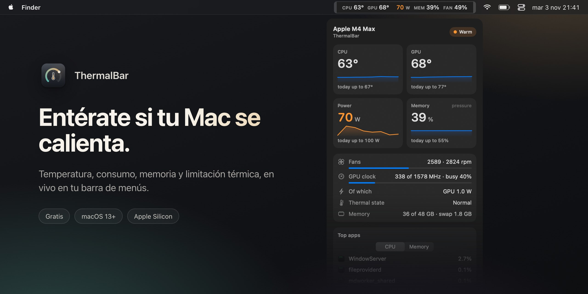

[English](README.md) · [Русский](README.ru.md) · [简体中文](README.zh-CN.md) · **Español** · [Türkçe](README.tr.md) · [العربية](README.ar.md) · [日本語](README.ja.md) · [Deutsch](README.de.md) · [Français](README.fr.md) · [한국어](README.ko.md)

<h3>Entérate si tu Mac se calienta.</h3>

Una app gratuita de barra de menús para Macs con Apple Silicon. Temperatura de CPU y GPU, consumo, presión de memoria, ventiladores y limitación térmica, en vivo, con colores y a un vistazo.

Gratis · macOS 13 Ventura o posterior · Apple Silicon M1–M5 · firmada y notarizada por Apple

 

---

## Por qué ThermalBar

Un Mac no avisa cuando se sobrecalienta. Simplemente se vuelve más lento: macOS baja las frecuencias sin decir nada, los ventiladores se aceleran, un juego pierde fotogramas, una exportación tarda más. ThermalBar pone las cifras donde siempre puedes verlas y te dice con claridad cuando algo va mal.

- **Un vistazo.** Las cifras se mantienen tranquilas mientras todo va bien y pasan a naranja, y luego a rojo, a medida que suben.
- **Te explica el porqué.** Ves el momento en que el calor empieza a frenar el Mac y cuándo la GPU se queda atascada a una frecuencia baja.
- **Nativa y ligera.** Una sola app pequeña. Sin Homebrew, sin proceso auxiliar, sin `sudo`, sin Electron, sin red.

## Todo en un clic

Haz clic en las cifras de la barra de menús y se abre el panel: temperaturas con tendencia de cinco minutos, máximos de hoy, consumo, presión de memoria y swap, ventiladores, frecuencia y carga de la GPU, las tres apps que más cargan tu Mac y tu última sesión de juego. El panel es de cristal, con control de transparencia, y sigue el modo claro y oscuro.

## Limitación térmica, GPU atascada, memoria al límite

- **Indicador de limitación térmica.** Aparece una pequeña señal en la barra de menús cuando macOS baja las frecuencias por el calor, con una pista sobre qué ayuda.
- **«GPU atascada a una frecuencia baja».** Si la GPU está al máximo de carga pero funciona a una fracción de su frecuencia máxima y el calor no lo explica, ThermalBar te lo dice. Normalmente se arregla reiniciando.
- **Presión de memoria, tal como la ve macOS.** No un engañoso «% de RAM», sino la misma valoración en verde, amarillo y rojo que usa el Monitor de Actividad, además del swap.
- **Notificaciones** para cada uno de estos casos, como máximo una cada 20 minutos. Cada una se puede desactivar.

## Estadísticas que puedes exportar

ThermalBar guarda en tu Mac un historial minuto a minuto durante 90 días. Elige hoy, 7 días, 30 días o fechas a medida, y guarda un informe limpio con gráficas (HTML, se abre en cualquier navegador) o una hoja de cálculo (CSV para Excel y Numbers). Las sesiones de juego se detectan solas, así que puedes ver cuánto se calentó de verdad tu última tarde de juego.

## Ajustes, no archivos de configuración

Elige qué muestra la barra de menús, una línea o dos, etiquetas y colores. Los umbrales parten de valores razonables para tu chip (base, Pro, Max o Ultra) y puedes cambiarlos a tu gusto. Inglés y ruso, según el idioma del sistema.

## Instalación

1. Descarga **[ThermalBar.zip](https://github.com/evilork/thermalbar/releases/latest/download/ThermalBar.zip)**.
2. Descomprímelo y arrastra **ThermalBar.app** a **Aplicaciones**.
3. Ábrela. La app está firmada y notarizada por Apple, así que se abre sin avisos.

ThermalBar se abre al iniciar sesión de forma predeterminada; desactívalo en **Ajustes → General (Settings → General)**.

**¿Actualizas desde la 1.0?** Cierra la app antigua y sustitúyela por la nueva. La versión 2.0 desactiva sola el antiguo ayudante `macmon`. `macmon` sigue instalado; elimínalo con `brew uninstall macmon` si nada más lo usa.

**Requisitos:** un Mac con Apple Silicon (M1 o posterior) y macOS 13 Ventura o posterior.

## Privacidad

ThermalBar solo lee sensores. Nunca cambia la velocidad de los ventiladores, las frecuencias ni los ajustes del sistema, no hace ninguna petición de red y nada sale de tu Mac. El historial de las estadísticas se queda en `~/Library/Application Support/ThermalBar`.

## Umbrales predeterminados

| Métrica | Naranja | Rojo | Insignia |
|---------|---------|------|----------|
| Temperatura de CPU y GPU | 70 °C | 85 °C | 95 °C |
| Consumo, chips base | 15 W | 30 W | 45 W |
| Consumo, chips Pro | 40 W | 70 W | 90 W |
| Consumo, chips Max | 60 W | 100 W | 130 W |
| Consumo, chips Ultra | 90 W | 150 W | 200 W |
| Ventiladores (porcentaje de la velocidad máxima) | 70 % | 90 % | — |
| Memoria | amarillo de macOS | — | rojo de macOS |

## ¿Qué monitor elegir?

ThermalBar hace una sola cosa: vigilar el calor. Responde a dos preguntas: «¿mi Mac se está calentando demasiado?» y «¿eso lo está frenando?».

- **Elige ThermalBar** si quieres temperatura, consumo, presión de memoria, ventiladores y limitación térmica explicados con palabras sencillas, con avisos y un historial que puedes exportar.
- **Elige Stats o iStat Menus** si además quieres red, disco, batería y gráficas por núcleo en la barra de menús. Stats es gratis y de código abierto, iStat Menus es de pago; ambos abarcan mucho más.
- **Elige una app de control de ventiladores** si quieres fijar tú mismo su velocidad. ThermalBar solo lee los sensores y nunca cambia nada.

## Preguntas frecuentes

**¿Cómo veo la temperatura de la CPU en un Mac?** macOS no la muestra en ningún sitio. Instala ThermalBar y las temperaturas de la CPU y la GPU aparecen al instante en la barra de menús, sin contraseña de administrador ni Terminal.

**¿Qué temperatura es normal en un Mac con Apple Silicon?** Apple no publica un límite. Con carga intensa los chips suelen trabajar entre 80 y 100 °C, sobre todo en los MacBook Air sin ventilador, y macOS protege el chip bajando sus frecuencias. Por eso lo útil es saber si el Mac está limitando su rendimiento, y ThermalBar muestra justo eso.

**¿Necesita sudo o contraseña de administrador?** No. ThermalBar no tiene proceso auxiliar ni pide contraseña; lee los mismos sensores que macOS usa para sí mismo.

**¿ThermalBar ralentiza el Mac?** No. En nuestras mediciones, con el panel cerrado, usa alrededor del 1 % de un núcleo de CPU y unos 100 MB de memoria. El panel solo se dibuja mientras está abierto.

**¿Es gratis?** Sí.

**¿Funciona en Macs con Intel?** No. Los sensores funcionan de otra manera en Intel; ThermalBar está hecha para Apple Silicon.

**¿Por qué no está en la Mac App Store?** Lee los sensores a través de interfaces del sistema de solo lectura que las apps de la App Store no pueden usar.

**¿La temperatura de la GPU es real?** Apple Silicon no tiene un único sensor de GPU. ThermalBar promedia los sensores de la parte de GPU del chip, lo que coincide con lo que muestran otros monitores.

**¿Es de código abierto?** La versión 1.0 lo era. A partir de la 2.0 el código fuente es cerrado; la app sigue siendo gratuita.

**¿Cómo la desinstalo?** Desactiva **Abrir al iniciar sesión (Open at login)** en los ajustes, cierra ThermalBar y arrástrala a la Papelera. Para borrar también los ajustes y el historial, elimina `~/.config/thermalbar` y `~/Library/Application Support/ThermalBar`.

## Apoyo

ThermalBar es gratuita. Si se ha ganado un sitio en tu barra de menús, una propina se agradece muchísimo.

| Moneda | Dirección |
|--------|-----------|
| **BTC** | `bc1pd47ssznzl6afr94zdkyk3g504h4l5m9etfg83lnwlsradg7yrrysk2wlt7` |
| **LTC** | `M9hXcyfRfaXajtzNbVV6pJwC5RoFbijfys` |
| **ETH** | `0x6e5afc8583239da03bf3fd21dd7fafe5e65e1670` |
| **SOL** | `FZ6jUxZUpzneTGgv4X7KAXmxjLrVAfksBojnw6mkEuqQ` |
| **TRON** | `TNHjSq6kc4bmt7tX5QGxd1YsGFa2XN62uQ` |
| **TON** | `UQCCFCDL7fDf6WTcEtAluxL9oAN8sKb3awjH7U752Xkzl1XI` |

¿Has encontrado un error o tienes una idea? [Abre una incidencia](https://github.com/evilork/thermalbar/issues).

---

**Si ThermalBar te resulta útil, dale una estrella ⭐ al repositorio: ayuda a que otros usuarios de Mac lo encuentren.**

Palabras clave

ThermalBar es un **monitor de temperatura para Mac** gratuito y un **monitor del sistema para macOS** ligero en la **barra de menús**: monitor de temperatura mac · temperatura cpu mac · temperatura macbook · temperatura gpu mac · programa gratis para ver la temperatura del mac · temperatura en la barra de menús mac · monitor de sistema mac gratis · **alternativa gratis a iStat Menus** · mac se sobrecalienta · cómo ver la temperatura del procesador en mac · cómo saber la temperatura de mi mac · limitación térmica mac · throttling macbook · frecuencia gpu mac · velocidad ventiladores mac · presión de memoria mac · consumo en vatios mac · temperatura Apple Silicon · temperatura M1 M2 M3 M4 M5 · temperatura M4 Max · mac temperature monitor · cpu temperature mac · istat menus alternative free · mac throttling monitor · apple silicon temperature monitor

Una alternativa gratuita y nativa a **iStat Menus**, **Stats**, **Fanny** y **Hot**, centrada en la temperatura, el consumo, la presión de memoria, los ventiladores y la limitación térmica.

