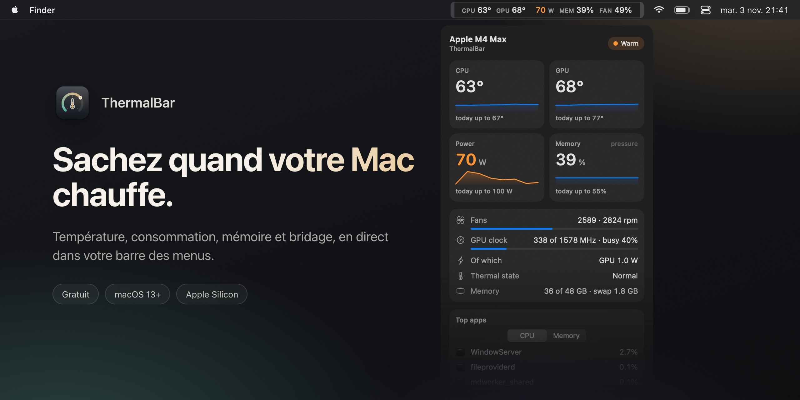

[English](README.md) · [Русский](README.ru.md) · [简体中文](README.zh-CN.md) · [Español](README.es.md) · [Türkçe](README.tr.md) · [العربية](README.ar.md) · [日本語](README.ja.md) · [Deutsch](README.de.md) · **Français** · [한국어](README.ko.md)

<h3>Sachez quand votre Mac chauffe.</h3>

Une app gratuite pour la barre des menus des Mac Apple Silicon. Température du CPU et du GPU, consommation, pression mémoire, ventilateurs et bridage thermique, en direct, avec un code couleur, d’un seul coup d’œil.

Gratuit · macOS 13 Ventura ou version ultérieure · Apple Silicon M1–M5 · signée et notariée par Apple

 

---

## Pourquoi ThermalBar

Un Mac ne vous prévient pas quand il surchauffe. Il ralentit, tout simplement : macOS baisse discrètement les fréquences, les ventilateurs s’emballent, un jeu perd des images, un export prend plus de temps. ThermalBar place les chiffres là où vous pouvez toujours les voir et vous dit clairement quand quelque chose ne va pas.

- **D’un coup d’œil.** Les chiffres restent calmes tant que tout va bien, puis passent à l’orange, puis au rouge à mesure qu’ils montent.
- **Il vous explique pourquoi.** Vous voyez le moment où la chaleur commence à ralentir le Mac, et quand le GPU reste bloqué à une fréquence basse.
- **Natif et léger.** Une seule petite app. Pas de Homebrew, pas de processus auxiliaire, pas de `sudo`, pas d’Electron, pas de réseau.

## Tout en un clic

Cliquez sur les chiffres dans la barre des menus et le panneau s’ouvre : températures avec tendance sur cinq minutes, pics du jour, consommation, pression mémoire et swap, ventilateurs, fréquence et charge du GPU, les trois apps qui sollicitent le plus votre Mac, et votre dernière session de jeu. Le panneau est en verre, avec un curseur de transparence, et suit le mode clair et sombre.

## Bridage thermique, GPU bloqué, mémoire saturée

- **Indicateur de bridage.** Un petit signe apparaît dans la barre des menus lorsque macOS baisse les fréquences à cause de la chaleur, avec une piste sur ce qui peut aider.
- **« GPU bloqué à une fréquence basse ».** Si le GPU est pleinement sollicité mais tourne à une fraction de sa fréquence maximale sans que la chaleur l’explique, ThermalBar vous le dit. Un redémarrage règle généralement le problème.
- **La pression mémoire, telle que macOS la voit.** Pas un « % de RAM » trompeur, mais la même évaluation verte, jaune et rouge que celle du Moniteur d’activité, plus le swap.
- **Des notifications** pour chacun de ces cas, au plus une toutes les 20 minutes. Chacune peut être désactivée.

## Des statistiques exportables

ThermalBar conserve sur votre Mac un historique minute par minute pendant 90 jours. Choisissez aujourd’hui, 7 jours, 30 jours ou des dates à votre guise, et enregistrez un rapport net avec graphiques (HTML, qui s’ouvre dans n’importe quel navigateur) ou un tableur (CSV pour Excel et Numbers). Les sessions de jeu sont détectées automatiquement : vous voyez à quel point votre dernière soirée de jeu a fait chauffer le Mac.

## Des réglages, pas des fichiers de configuration

Choisissez ce qu’affiche la barre des menus, une ligne ou deux, les libellés et les couleurs. Les seuils partent de valeurs adaptées à votre puce (de base, Pro, Max ou Ultra) et vous pouvez les modifier. Anglais et russe, selon la langue de votre système.

## Installation

1. Téléchargez **[ThermalBar.zip](https://github.com/evilork/thermalbar/releases/latest/download/ThermalBar.zip)**.
2. Décompressez-le et faites glisser **ThermalBar.app** dans **Applications**.
3. Ouvrez-la. L’app est signée et notariée par Apple, elle s’ouvre donc sans avertissement.

ThermalBar s’ouvre à la connexion par défaut ; désactivez cette option dans **Réglages → Général (Settings → General)**.

**Vous passez de la 1.0 ?** Quittez l’ancienne app et remplacez-la par la nouvelle. La version 2.0 désactive d’elle-même l’ancien assistant `macmon`. `macmon` reste installé ; supprimez-le avec `brew uninstall macmon` si rien d’autre ne l’utilise.

**Configuration requise :** un Mac Apple Silicon (M1 ou plus récent) et macOS 13 Ventura ou version ultérieure.

## Confidentialité

ThermalBar ne fait que lire les capteurs. Il ne modifie jamais la vitesse des ventilateurs, les fréquences ou les réglages du système, n’envoie aucune requête réseau, et rien ne quitte votre Mac. L’historique des statistiques reste dans `~/Library/Application Support/ThermalBar`.

## Seuils par défaut

| Mesure | Orange | Rouge | Badge |
|--------|--------|-------|-------|
| Température du CPU et du GPU | 70 °C | 85 °C | 95 °C |
| Consommation, puces de base | 15 W | 30 W | 45 W |
| Consommation, puces Pro | 40 W | 70 W | 90 W |
| Consommation, puces Max | 60 W | 100 W | 130 W |
| Consommation, puces Ultra | 90 W | 150 W | 200 W |
| Ventilateurs (part de la vitesse maximale) | 70 % | 90 % | — |
| Mémoire | jaune de macOS | — | rouge de macOS |

## Quel moniteur choisir ?

ThermalBar fait une seule chose : surveiller la chaleur. Il répond à deux questions : « mon Mac chauffe-t-il trop ? » et « est-ce que ça le ralentit ? »

- **Choisissez ThermalBar** si vous voulez la température, la consommation, la pression mémoire, les ventilateurs et le bridage expliqués simplement, avec des alertes et un historique exportable.
- **Choisissez Stats ou iStat Menus** si vous voulez aussi le réseau, le disque, la batterie et des graphiques par cœur dans la barre des menus. Stats est gratuit et open source, iStat Menus est payant ; tous deux couvrent bien plus de terrain.
- **Choisissez une app de contrôle des ventilateurs** si vous voulez régler leur vitesse vous-même. ThermalBar se contente de lire les capteurs et ne modifie jamais rien.

## FAQ

**Comment voir la température du processeur sur un Mac ?** macOS ne l’affiche nulle part. Installez ThermalBar : les températures du CPU et du GPU apparaissent aussitôt dans la barre des menus, sans mot de passe administrateur ni Terminal.

**Quelle température est normale pour un Mac Apple Silicon ?** Apple ne publie pas de limite. Sous forte charge, les puces tournent souvent entre 80 et 100 °C, surtout dans les MacBook Air sans ventilateur, et macOS protège la puce en baissant ses fréquences. La vraie question est donc de savoir si le Mac est bridé, et c’est exactement ce que montre ThermalBar.

**Faut-il sudo ou un mot de passe administrateur ?** Non. ThermalBar n’a pas de processus auxiliaire et ne demande aucun mot de passe ; il lit les mêmes capteurs que macOS lit pour lui-même.

**ThermalBar ralentit-il le Mac ?** Non. D’après nos mesures, panneau fermé, il utilise environ 1 % d’un cœur de processeur et près de 100 Mo de mémoire. Le panneau n’est dessiné que lorsqu’il est ouvert.

**Est-ce gratuit ?** Oui.

**Fonctionne-t-il sur les Mac Intel ?** Non. Les capteurs fonctionnent différemment sur Intel ; ThermalBar est conçu pour Apple Silicon.

**Pourquoi n’est-il pas sur le Mac App Store ?** Il lit les capteurs via des interfaces système en lecture seule que les apps de l’App Store n’ont pas le droit d’utiliser.

**La température du GPU est-elle réelle ?** Apple Silicon n’a pas de capteur GPU unique. ThermalBar fait la moyenne des capteurs de la partie GPU de la puce, ce qui correspond à ce qu’affichent les autres moniteurs.

**Est-il open source ?** La version 1.0 l’était. À partir de la 2.0, le code source est fermé ; l’app reste gratuite.

**Comment le désinstaller ?** Désactivez **Ouvrir à la connexion (Open at login)** dans les réglages, quittez ThermalBar et faites-le glisser dans la corbeille. Pour supprimer aussi les réglages et l’historique, effacez `~/.config/thermalbar` et `~/Library/Application Support/ThermalBar`.

## Soutien

ThermalBar est gratuit. S’il a mérité sa place dans votre barre des menus, un pourboire est très apprécié.

| Crypto | Adresse |
|--------|---------|
| **BTC** | `bc1pd47ssznzl6afr94zdkyk3g504h4l5m9etfg83lnwlsradg7yrrysk2wlt7` |
| **LTC** | `M9hXcyfRfaXajtzNbVV6pJwC5RoFbijfys` |
| **ETH** | `0x6e5afc8583239da03bf3fd21dd7fafe5e65e1670` |
| **SOL** | `FZ6jUxZUpzneTGgv4X7KAXmxjLrVAfksBojnw6mkEuqQ` |
| **TRON** | `TNHjSq6kc4bmt7tX5QGxd1YsGFa2XN62uQ` |
| **TON** | `UQCCFCDL7fDf6WTcEtAluxL9oAN8sKb3awjH7U752Xkzl1XI` |

Un bug ou une idée ? [Ouvrez une issue](https://github.com/evilork/thermalbar/issues).

---

**Si ThermalBar vous est utile, mettez une étoile ⭐ au dépôt : cela aide d’autres utilisateurs de Mac à le trouver.**

Mots-clés

ThermalBar est un **moniteur de température pour Mac** gratuit et un **moniteur système macOS** léger pour la **barre des menus** : température mac · température cpu mac · température macbook · température gpu mac · logiciel gratuit température mac · afficher la température dans la barre des menus mac · moniteur système mac gratuit · **alternative gratuite à iStat Menus** · macbook qui surchauffe · comment voir la température du processeur sur mac · comment connaître la température de son mac · bridage thermique mac · throttling macbook · vitesse ventilateur mac · pression mémoire mac · consommation en watts mac · température Apple Silicon · température M1 M2 M3 M4 M5 · température M4 Max · mac temperature monitor · cpu temperature mac · istat menus alternative free · mac throttling monitor · apple silicon temperature monitor

Une alternative gratuite et native à **iStat Menus**, **Stats**, **Fanny** et **Hot**, centrée sur la température, la consommation, la pression mémoire, les ventilateurs et le bridage thermique.

