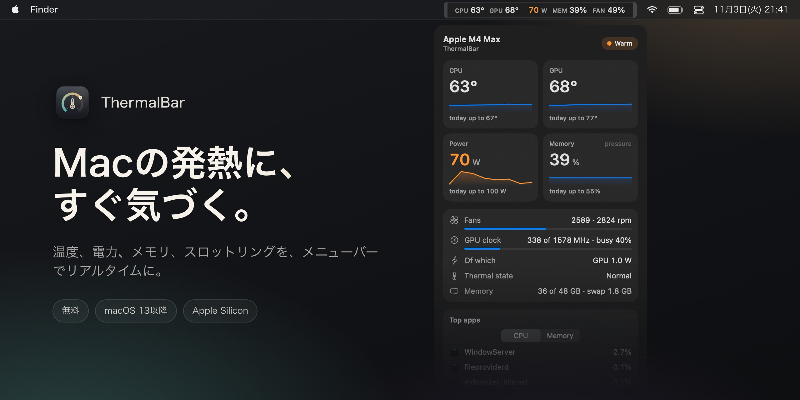

<div align="center">

<a href="https://github.com/evilork/thermalbar/releases/latest"></a>

[English](README.md) · [Русский](README.ru.md) · [简体中文](README.zh-CN.md) · [Español](README.es.md) · [Türkçe](README.tr.md) · [العربية](README.ar.md) · **日本語** · [Deutsch](README.de.md) · [Français](README.fr.md) · [한국어](README.ko.md)

<h3>Macの発熱に、すぐ気づく。</h3>

Apple Silicon搭載Mac向けの無料メニューバーアプリ。CPUとGPUの温度、消費電力、メモリプレッシャー、ファン、サーマルスロットリングを、色分けしてリアルタイムに。ひと目で確認できます。

<a href="https://github.com/evilork/thermalbar/releases/latest/download/ThermalBar.zip"></a>

<sub>無料 · macOS 13 Ventura以降 · Apple Silicon M1–M5 · Appleによる署名・公証済み</sub>

<br>

[](https://github.com/evilork/thermalbar/releases)
[](https://github.com/evilork/thermalbar/stargazers)
[](https://github.com/evilork/thermalbar/releases/latest)
[](#インストール)

</div>

---

## ThermalBarを選ぶ理由

Macは、熱くなっても教えてくれません。ただ遅くなるだけです。macOSは静かにクロックを下げ、ファンが回り出し、ゲームはコマ落ちし、書き出しに時間がかかります。ThermalBarは数値をいつでも見える場所に置き、何か問題があればはっきりとお知らせします。

- **ひと目でわかる。** 問題がないあいだ数値は落ち着いたまま。上がるにつれてオレンジ、そして赤に変わります。
- **理由もわかる。** 熱でMacが遅くなり始めた瞬間や、GPUが低いクロックのまま動かなくなったときがわかります。
- **ネイティブで軽い。** 小さなアプリがひとつだけ。Homebrewも、ヘルパープロセスも、`sudo`も、Electronも、ネットワーク通信も不要です。

## ワンクリックで全部

<p align="center"></p>

メニューバーの数値をクリックするとパネルが開きます。5分間の推移つきの温度、今日のピーク、消費電力、メモリプレッシャーとスワップ、ファン、GPUのクロックと負荷、Macに最も負荷をかけている3つのアプリ、直近のゲームセッション。パネルはガラス調で、透明度のスライダーがあり、ライトモードとダークモードに合わせて表示されます。

## スロットリング、GPUの停滞、メモリ不足

- **スロットリング表示。** 熱のためにmacOSがクロックを下げると、メニューバーに小さな印が現れ、何が効くかのヒントも表示されます。
- **「GPUが低いクロックで停滞」。** GPUが全力で動いているのに最高クロックのごく一部でしか動作せず、熱では説明がつかない場合、ThermalBarがお知らせします。たいていは再起動で直ります。
- **macOSの見方どおりのメモリプレッシャー。** 誤解を招く「RAM使用率」ではなく、アクティビティモニタと同じ緑・黄・赤の評価に、スワップを加えて表示します。
- **通知**はそれぞれ最大20分に1回。どれも個別にオフにできます。

## 書き出せる統計

<p align="center"></p>

ThermalBarは、1分ごとの履歴をMac上に90日間保存します。今日、7日間、30日間、または任意の日付を選んで、グラフつきのすっきりしたレポート（HTML、どのブラウザでも開けます）や、表計算用のファイル（ExcelとNumbers向けのCSV）として保存できます。ゲームセッションは自動で検出されるので、昨夜のゲームでどれだけ熱くなったかがわかります。

## 設定ファイルではなく、設定画面で

<p align="center"></p>

メニューバーに何を表示するか、1行か2行か、ラベルと色を選べます。しきい値はお使いのチップ（ベース、Pro、Max、Ultra）に合った妥当な値から始まり、自由に変更できます。英語とロシア語に対応し、システムの言語に合わせて選ばれます。

## インストール

1. **[ThermalBar.zip](https://github.com/evilork/thermalbar/releases/latest/download/ThermalBar.zip)** をダウンロードします。
2. 解凍して、**ThermalBar.app** を「アプリケーション」フォルダにドラッグします。
3. 開きます。アプリはAppleによる署名と公証を受けているので、警告なしで開きます。

[Homebrew](https://brew.sh) でもインストールできます：

```sh
brew install --cask evilork/tap/thermalbar
```

ThermalBarは初期設定でログイン時に開きます。オフにするには **設定 → 一般（Settings → General）** を開いてください。

**1.0からアップグレードする場合は？** 古いアプリを終了して、新しいものに置き換えてください。バージョン2.0は、古い`macmon`ヘルパーを自動でオフにします。`macmon`自体はインストールされたままです。ほかに使うものがなければ、`brew uninstall macmon`で削除できます。

**動作環境：** Apple Silicon搭載Mac（M1以降）と、macOS 13 Ventura以降。

## プライバシー

ThermalBarはセンサーを読み取るだけです。ファンの回転数、クロック、システム設定を変更することはなく、ネットワークにも接続せず、Macの外に出るものは何もありません。統計用の履歴は`~/Library/Application Support/ThermalBar`に保存されます。

## 初期のしきい値

| 項目 | オレンジ | 赤 | バッジ |
|------|----------|----|--------|
| CPUとGPUの温度 | 70 °C | 85 °C | 95 °C |
| 消費電力、ベースチップ | 15 W | 30 W | 45 W |
| 消費電力、Proチップ | 40 W | 70 W | 90 W |
| 消費電力、Maxチップ | 60 W | 100 W | 130 W |
| 消費電力、Ultraチップ | 90 W | 150 W | 200 W |
| ファン（最高回転数に対する割合） | 70% | 90% | — |
| メモリ | macOSの黄 | — | macOSの赤 |

## どのモニターを選べばいい？

ThermalBarの仕事はひとつ、熱を見ることです。答えるのは2つの問い、「Macが熱くなりすぎていないか」と「そのせいで遅くなっていないか」です。

- **ThermalBarを選ぶ**のは、温度、電力、メモリプレッシャー、ファン、スロットリングをわかりやすい言葉で知りたいとき。通知と書き出せる履歴もあります。
- **StatsやiStat Menusを選ぶ**のは、ネットワーク、ディスク、バッテリー、コアごとのグラフもメニューバーに出したいとき。Statsは無料でオープンソース、iStat Menusは有料で、どちらもずっと広い範囲をカバーします。
- **ファン制御アプリを選ぶ**のは、ファンの速度を自分で決めたいとき。ThermalBarはセンサーを読むだけで、何も変更しません。

## よくある質問

**MacでCPU温度を確認するには？** macOSはどこにも表示しません。ThermalBarを入れれば、管理者パスワードもターミナルも使わずに、CPUとGPUの温度がすぐメニューバーに表示されます。

**Apple SiliconのMacの正常な温度は？** Appleは上限を公表していません。高負荷時には80〜100 °Cで動くことがよくあり、ファンのないMacBook Airでは特にそうです。macOSはクロックを下げてチップを守ります。だから大事なのはスロットリングが起きているかどうかで、ThermalBarはまさにそれを表示します。

**sudoや管理者パスワードは必要ですか？** いいえ。ThermalBarにはヘルパープロセスがなく、パスワードも求めません。macOS自身が読んでいるのと同じセンサーを読んでいます。

**ThermalBarでMacが遅くなりませんか？** なりません。私たちの計測では、パネルを閉じているあいだの使用量はCPUコア1つの約1%、メモリは約100 MBです。パネルは開いているときだけ描画されます。

**無料ですか？** はい。

**IntelのMacで動きますか？** いいえ。Intelではセンサーの仕組みが異なります。ThermalBarはApple Silicon向けに作られています。

**Mac App Storeにないのはなぜですか？** 読み取り専用のシステムインターフェースを通じてセンサーを読んでおり、App Storeのアプリはそれを使えないためです。

**GPU温度は本物ですか？** Apple Siliconには、GPU専用の単一のセンサーはありません。ThermalBarはチップのGPU部分にある複数のセンサーの平均を取っており、他のモニターの表示とも一致します。

**オープンソースですか？** バージョン1.0はそうでした。2.0からはソースコードは非公開ですが、アプリは引き続き無料です。

**アンインストールするには？** 設定で**ログイン時に開く**（Open at login）をオフにし、ThermalBarを終了して、ゴミ箱にドラッグします。設定と履歴も削除するには、`~/.config/thermalbar`と`~/Library/Application Support/ThermalBar`を削除してください。

## サポート

ThermalBarは無料です。メニューバーに置く価値があると感じていただけたなら、投げ銭をいただけるととても励みになります。

| コイン | アドレス |
|--------|----------|
| **BTC** | `bc1pd47ssznzl6afr94zdkyk3g504h4l5m9etfg83lnwlsradg7yrrysk2wlt7` |
| **LTC** | `M9hXcyfRfaXajtzNbVV6pJwC5RoFbijfys` |
| **ETH** | `0x6e5afc8583239da03bf3fd21dd7fafe5e65e1670` |
| **SOL** | `FZ6jUxZUpzneTGgv4X7KAXmxjLrVAfksBojnw6mkEuqQ` |
| **TRON** | `TNHjSq6kc4bmt7tX5QGxd1YsGFa2XN62uQ` |
| **TON** | `UQCCFCDL7fDf6WTcEtAluxL9oAN8sKb3awjH7U752Xkzl1XI` |

バグを見つけた、またはアイデアがある場合は、[issueを作成してください](https://github.com/evilork/thermalbar/issues)。

---

<div align="center">

**ThermalBarが役に立ったら、リポジトリにスター ⭐ をお願いします。ほかのMacユーザーが見つけやすくなります。**

</div>

<details>
<summary><sub>キーワード</sub></summary>

<sub>

ThermalBarは、**メニューバー**で使える無料の**Mac温度モニター**であり、軽量な**macOSシステムモニター**です：Mac 温度 モニター · Mac CPU温度 · MacBook 温度 確認 · Mac GPU温度 · Mac 温度 確認 無料 · メニューバー 温度 表示 Mac · Mac システムモニター 無料 · **iStat Menus 代替 無料** · MacBook 熱い · Mac CPU温度 確認方法 · MacBook 発熱 対策 · Mac サーマルスロットリング · Mac ファン 回転数 · Mac メモリプレッシャー · Mac 消費電力 W · Apple Silicon 温度 · M1 M2 M3 M4 M5 温度 · M4 Max 温度 · mac temperature monitor · cpu temperature mac · istat menus alternative free · mac throttling monitor · apple silicon temperature monitor

**iStat Menus**、**Stats**、**Fanny**、**Hot**に代わる、温度、消費電力、メモリプレッシャー、ファン、スロットリングに特化した、無料のネイティブアプリです。

</sub>

</details>
