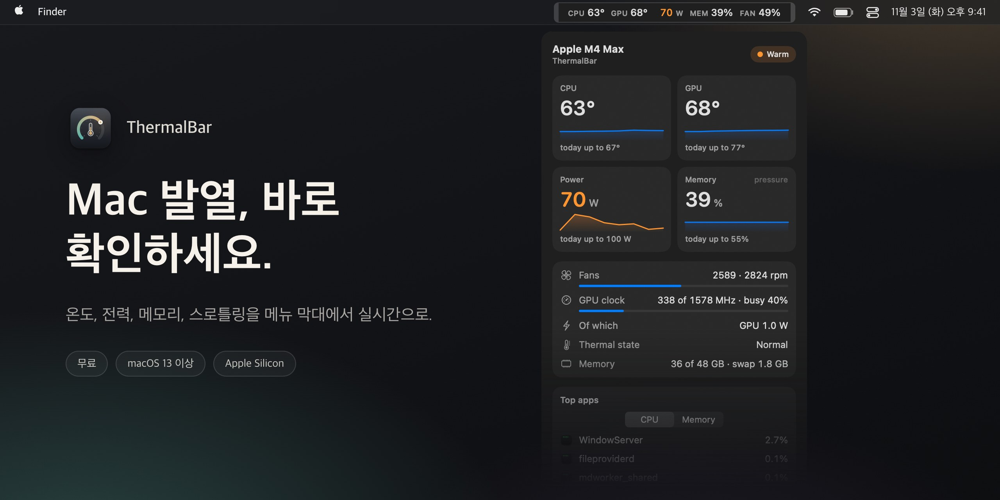

[English](README.md) · [Русский](README.ru.md) · [简体中文](README.zh-CN.md) · [Español](README.es.md) · [Türkçe](README.tr.md) · [العربية](README.ar.md) · [日本語](README.ja.md) · [Deutsch](README.de.md) · [Français](README.fr.md) · **한국어**

<h3>Mac 발열, 바로 확인하세요.</h3>

Apple Silicon Mac을 위한 무료 메뉴 막대 앱. CPU와 GPU 온도, 전력, 메모리 압력, 팬, 성능 제한(스로틀링)을 색상으로 구분해 실시간으로, 한눈에 보여 줍니다.

무료 · macOS 13 Ventura 이상 · Apple Silicon M1–M5 · Apple 서명 및 공증 완료

 

---

## ThermalBar를 쓰는 이유

Mac은 과열돼도 알려 주지 않습니다. 그저 느려질 뿐입니다. macOS가 조용히 클럭을 낮추고, 팬이 빨리 돌고, 게임은 프레임이 떨어지고, 내보내기는 오래 걸립니다. ThermalBar는 숫자를 항상 보이는 곳에 두고, 문제가 생기면 분명하게 알려 줍니다.

- **한눈에 확인.** 이상이 없을 때는 숫자가 차분하게 유지되고, 올라갈수록 주황색, 이어서 빨간색으로 바뀝니다.
- **이유를 알려 줍니다.** 열 때문에 Mac이 느려지기 시작하는 순간과, GPU가 낮은 클럭에 걸려 움직이지 않는 순간을 볼 수 있습니다.
- **네이티브이고 가볍습니다.** 작은 앱 하나뿐입니다. Homebrew도, 보조 프로세스도, `sudo`도, Electron도, 네트워크도 필요 없습니다.

## 클릭 한 번으로 전부

메뉴 막대의 숫자를 클릭하면 패널이 열립니다. 5분 추이가 포함된 온도, 오늘의 최고치, 전력, 메모리 압력과 스왑, 팬, GPU 클럭과 부하, Mac에 가장 부담을 주는 앱 세 개, 가장 최근의 게임 세션까지 볼 수 있습니다. 패널은 유리 질감이며 투명도 슬라이더가 있고, 라이트 모드와 다크 모드를 따릅니다.

## 스로틀링, 멈춘 GPU, 부족한 메모리

- **스로틀링 표시.** 열 때문에 macOS가 클럭을 낮추면 메뉴 막대에 작은 표시가 나타나고, 어떻게 하면 도움이 되는지 힌트도 함께 보여 줍니다.
- **“GPU가 낮은 클럭에 멈춤”.** GPU가 완전히 바쁜데도 최고 클럭의 일부로만 동작하고 열로는 설명되지 않으면 ThermalBar가 알려 줍니다. 보통은 재시동하면 해결됩니다.
- **macOS가 보는 그대로의 메모리 압력.** 오해를 부르는 “RAM %”가 아니라 활성 상태 보기에서 쓰는 것과 같은 초록, 노랑, 빨강 등급에 스왑을 더해 보여 줍니다.
- **알림**은 항목마다 20분에 최대 한 번만 옵니다. 각각 끌 수 있습니다.

## 내보낼 수 있는 통계

ThermalBar는 Mac에 1분 단위 기록을 90일 동안 보관합니다. 오늘, 7일, 30일 또는 원하는 날짜를 고른 뒤, 차트가 포함된 깔끔한 리포트(HTML, 어떤 브라우저에서든 열림)나 스프레드시트(Excel과 Numbers용 CSV)로 저장할 수 있습니다. 게임 세션은 자동으로 감지되므로, 지난밤 게임 중에 Mac이 얼마나 뜨거워졌는지 확인할 수 있습니다.

## 설정 파일 말고, 설정 화면

메뉴 막대에 무엇을 보일지, 한 줄이나 두 줄, 레이블과 색상을 고를 수 있습니다. 임계값은 사용 중인 칩(기본형, Pro, Max, Ultra)에 맞는 적절한 값으로 시작하며 원하는 대로 바꿀 수 있습니다. 영어와 러시아어를 지원하며 시스템 언어에 맞춰 선택됩니다.

## 설치

1. **[ThermalBar.zip](https://github.com/evilork/thermalbar/releases/latest/download/ThermalBar.zip)** 을 다운로드합니다.
2. 압축을 풀고 **ThermalBar.app** 을 **응용 프로그램** 폴더로 드래그합니다.
3. 엽니다. 앱은 Apple의 서명과 공증을 받았으므로 경고 없이 열립니다.

ThermalBar는 기본적으로 로그인할 때 열립니다. 끄려면 **설정 → 일반(Settings → General)** 에서 해제하세요.

**1.0에서 업그레이드하나요?** 이전 앱을 종료하고 새 앱으로 교체하세요. 2.0 버전은 예전 `macmon` 도우미를 알아서 끕니다. `macmon`은 설치된 채로 남아 있으며, 다른 곳에서 쓰지 않는다면 `brew uninstall macmon`으로 지울 수 있습니다.

**요구 사항:** Apple Silicon Mac(M1 이상)과 macOS 13 Ventura 이상.

## 개인정보 보호

ThermalBar는 센서를 읽기만 합니다. 팬 속도, 클럭, 시스템 설정은 절대 바꾸지 않고, 네트워크 요청도 하지 않으며, 어떤 데이터도 Mac 밖으로 나가지 않습니다. 통계용 기록은 `~/Library/Application Support/ThermalBar`에 남습니다.

## 기본 임계값

| 항목 | 주황 | 빨강 | 배지 |
|------|------|------|------|
| CPU와 GPU 온도 | 70 °C | 85 °C | 95 °C |
| 전력, 기본형 칩 | 15 W | 30 W | 45 W |
| 전력, Pro 칩 | 40 W | 70 W | 90 W |
| 전력, Max 칩 | 60 W | 100 W | 130 W |
| 전력, Ultra 칩 | 90 W | 150 W | 200 W |
| 팬(최고 속도 대비 비율) | 70% | 90% | — |
| 메모리 | macOS 노랑 | — | macOS 빨강 |

## 어떤 모니터를 골라야 할까요?

ThermalBar는 한 가지 일만 합니다. 바로 열입니다. 두 가지 질문에 답합니다. “내 Mac이 너무 뜨거운가?” 그리고 “그 때문에 느려지고 있는가?”

- **ThermalBar를 고르세요.** 온도, 전력, 메모리 압력, 팬, 스로틀링을 쉬운 말로 보고, 알림과 내보낼 수 있는 기록까지 원한다면요.
- **Stats 또는 iStat Menus를 고르세요.** 메뉴 막대에서 네트워크, 디스크, 배터리, 코어별 그래프까지 보고 싶다면요. Stats는 무료 오픈 소스, iStat Menus는 유료이며, 둘 다 훨씬 넓은 범위를 다룹니다.
- **팬 제어 앱을 고르세요.** 팬 속도를 직접 정하고 싶다면요. ThermalBar는 센서를 읽기만 하고 아무것도 바꾸지 않습니다.

## 자주 묻는 질문

**Mac에서 CPU 온도는 어떻게 확인하나요?** macOS는 어디에도 보여 주지 않습니다. ThermalBar를 설치하면 관리자 암호나 터미널 없이 CPU와 GPU 온도가 바로 메뉴 막대에 나타납니다.

**Apple Silicon Mac의 정상 온도는 몇 도인가요?** Apple은 한계를 공개하지 않습니다. 부하가 높을 때 칩은 80~100 °C에서 동작하는 경우가 많고, 팬이 없는 MacBook Air는 특히 그렇습니다. macOS는 클럭을 낮춰 칩을 보호합니다. 그래서 중요한 것은 Mac이 스로틀링 중인지이고, ThermalBar는 바로 그것을 보여 줍니다.

**sudo나 관리자 암호가 필요한가요?** 아니요. ThermalBar에는 보조 프로세스가 없고 암호도 묻지 않습니다. macOS가 스스로 읽는 것과 같은 센서를 읽습니다.

**ThermalBar 때문에 Mac이 느려지나요?** 아니요. 저희가 측정해 보니 패널이 닫혀 있을 때 CPU 코어 하나의 약 1%, 메모리는 약 100MB만 씁니다. 패널은 열려 있을 때만 그립니다.

**무료인가요?** 네.

**Intel Mac에서도 되나요?** 아니요. Intel은 센서 방식이 달라서, ThermalBar는 Apple Silicon 전용으로 만들었습니다.

**왜 Mac App Store에 없나요?** 읽기 전용 시스템 인터페이스로 센서를 읽는데, App Store 앱은 이 인터페이스를 쓸 수 없기 때문입니다.

**GPU 온도는 실제 값인가요?** Apple Silicon에는 GPU 전용 센서가 하나만 있지 않습니다. ThermalBar는 칩의 GPU 영역에 있는 센서들의 평균을 내며, 다른 모니터링 앱이 보여 주는 값과 일치합니다.

**오픈 소스인가요?** 1.0 버전은 그랬습니다. 2.0부터는 소스 코드가 비공개이며, 앱은 계속 무료입니다.

**어떻게 삭제하나요?** 설정에서 **로그인 시 열기(Open at login)** 를 끄고, ThermalBar를 종료한 뒤 휴지통으로 드래그하세요. 설정과 기록까지 지우려면 `~/.config/thermalbar`와 `~/Library/Application Support/ThermalBar`를 삭제하세요.

## 후원

ThermalBar는 무료입니다. 메뉴 막대 한자리를 차지할 만했다면, 후원해 주시면 큰 힘이 됩니다.

| 코인 | 주소 |
|------|------|
| **BTC** | `bc1pd47ssznzl6afr94zdkyk3g504h4l5m9etfg83lnwlsradg7yrrysk2wlt7` |
| **LTC** | `M9hXcyfRfaXajtzNbVV6pJwC5RoFbijfys` |
| **ETH** | `0x6e5afc8583239da03bf3fd21dd7fafe5e65e1670` |
| **SOL** | `FZ6jUxZUpzneTGgv4X7KAXmxjLrVAfksBojnw6mkEuqQ` |
| **TRON** | `TNHjSq6kc4bmt7tX5QGxd1YsGFa2XN62uQ` |
| **TON** | `UQCCFCDL7fDf6WTcEtAluxL9oAN8sKb3awjH7U752Xkzl1XI` |

버그를 발견했거나 아이디어가 있나요? [이슈를 등록해 주세요](https://github.com/evilork/thermalbar/issues).

---

**ThermalBar가 도움이 되었다면 저장소에 스타 ⭐ 를 눌러 주세요. 다른 Mac 사용자가 찾는 데 도움이 됩니다.**

키워드

ThermalBar는 **메뉴 막대**용 무료 **Mac 온도 모니터**이자 가벼운 **macOS 시스템 모니터**입니다: 맥 온도 모니터 · 맥 CPU 온도 · 맥북 온도 확인 · 맥 GPU 온도 · 맥 온도 확인 프로그램 무료 · 메뉴 막대 온도 표시 맥 · 맥 시스템 모니터 무료 · **iStat Menus 대체 무료** · 맥북 발열 · 맥 CPU 온도 확인 방법 · 맥북 발열 확인 · 맥 스로틀링 · 맥 팬 속도 · 맥 메모리 압력 · 맥 전력 소비 W · Apple Silicon 온도 · M1 M2 M3 M4 M5 온도 · M4 Max 온도 · mac temperature monitor · cpu temperature mac · istat menus alternative free · mac throttling monitor · apple silicon temperature monitor

온도, 전력, 메모리 압력, 팬, 스로틀링에 집중한 **iStat Menus**, **Stats**, **Fanny**, **Hot**의 무료 네이티브 대안입니다.

