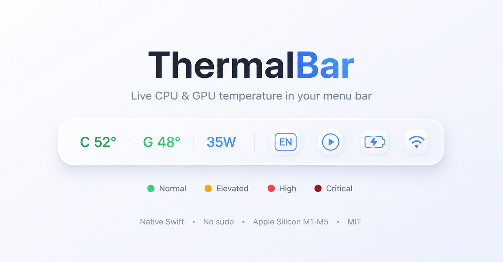

<div align="center">



# 🌡️ ThermalBar

### macOS menu bar CPU & GPU temperature monitor - native, color-coded, lightweight, free.

**A free Mac temperature monitor that lives in your menu bar.** Live CPU temperature, GPU temperature, RAM usage, and power draw - color-coded, no `sudo`, no Electron. Built for Apple Silicon (M1, M2, M3, M4, M4 Max, M5).

[](https://www.apple.com/macos/)
[](https://support.apple.com/en-us/116943)
[](https://swift.org)
[](LICENSE)
[]()

</div>

---

## Why ThermalBar?

Apple hides chip temperature behind private APIs. Most Mac temperature monitors are heavy Electron apps or need `sudo` every launch, and a full suite like iStat Menus costs money. ThermalBar is a **tiny native Swift app** - a free, lightweight, menu-bar Mac CPU/GPU temperature monitor that reads sensors directly and shows them as **color-coded numbers** in your menu bar - nothing else running, no dock icon, no bloat.

- 🟢 **Color-coded at a glance** - green when cool, orange when warm, red when hot, dark red when critical. Each value colored independently.
- 🌡️ **CPU temperature** read natively via IOKit - works with zero dependencies.
- 🎮 **GPU temperature + power draw (W)** via an optional lightweight helper.
- 🧠 **RAM usage (%)** - live memory pressure right in the menu bar.
- 🪶 **Featherweight** - pure Swift, no Electron, no background bloat, no dock icon.
- 🔧 **Fully configurable** - toggle any metric, set your own color thresholds.
- 🔐 **No sudo, ever** - reads sensors through a private API without root.
- 🚀 **Auto-starts on login**, stays out of your way.

## Install

```bash
git clone https://github.com/evilork/thermalbar.git
cd thermalbar
./install.sh
```

That's it. The installer builds the app, drops it in `/Applications`, and sets up auto-start. The menu bar numbers appear in a few seconds.

> First launch is unsigned - if macOS blocks it, right-click `ThermalBar.app` in `/Applications` → **Open** (one time).

### Requirements

- Apple Silicon Mac (M1-M5), macOS 13+
- [Xcode Command Line Tools](https://developer.apple.com/) - `xcode-select --install`
- [Homebrew](https://brew.sh) *(optional, for GPU temp + power)* - the installer auto-installs [`macmon`](https://github.com/vladkens/macmon) if present

CPU temperature works out of the box. GPU temperature and power require `macmon` (handled automatically by the installer).

## Configuration

Click the menu bar item to toggle metrics on/off, or edit `~/.config/thermalbar/config.json`:

```jsonc
{
  "cpuTemp": { "enabled": true, "thresholds": { "normal": 60, "warn": 75, "high": 90 } },
  "gpuTemp": { "enabled": true, "thresholds": { "normal": 60, "warn": 75, "high": 90 } },
  "power":   { "enabled": true, "thresholds": { "normal": 30, "warn": 55, "high": 80 } },
  "ram":     { "enabled": true, "thresholds": { "normal": 70, "warn": 85, "high": 95 } },
  "intervalSeconds": 3,
  "showLabels": true
}
```

| Field | What it does |
|-------|--------------|
| `enabled` | show this metric in the bar |
| `thresholds.normal / warn / high` | color cutoffs (°C for temps, W for power, % for RAM) |
| `intervalSeconds` | how often to refresh |
| `showLabels` | prefix `C` / `G` / `R` before values |

**Color rule:** `value < normal` → 🟢 · `< warn` → 🟠 · `< high` → 🔴 · `≥ high` → 🟥
After editing, pick **Reload config** from the menu.

## How it works

- **CPU** - reads `PMU tdie` die-sensors directly through IOKit's private HID interface (the same source `powermetrics` uses), no root needed.
- **GPU, power & RAM** - a background `macmon serve` process exposes these over a local HTTP endpoint; ThermalBar reads them on each refresh. If the helper isn't running, those metrics simply hide and CPU keeps working.

> **Note on GPU temperature:** Apple Silicon does not expose a dedicated GPU temperature sensor - CPU and GPU share one die. ThermalBar reports the GPU figure from `macmon`'s averaged die readings, so it reflects the GPU region of the chip.

## Uninstall

```bash
./uninstall.sh
```

Removes the app, both launch agents, and config. (Leaves `macmon` - remove with `brew uninstall macmon` if you want.)

## Support / Donate

ThermalBar is free and open source. If it earned a spot in your menu bar, a tip is hugely appreciated 🙏

| Coin | Address |
|------|---------|
| **BTC** | `bc1pd47ssznzl6afr94zdkyk3g504h4l5m9etfg83lnwlsradg7yrrysk2wlt7` |
| **LTC** | `M9hXcyfRfaXajtzNbVV6pJwC5RoFbijfys` |
| **ETH** | `0x6e5afc8583239da03bf3fd21dd7fafe5e65e1670` |
| **SOL** | `FZ6jUxZUpzneTGgv4X7KAXmxjLrVAfksBojnw6mkEuqQ` |
| **TRON** | `TNHjSq6kc4bmt7tX5QGxd1YsGFa2XN62uQ` |
| **TON** | `UQCCFCDL7fDf6WTcEtAluxL9oAN8sKb3awjH7U752Xkzl1XI` |

## License

[MIT](LICENSE) © evilork

---

<div align="center">
<sub>Built for Apple Silicon. Star ⭐ if it's useful - it helps others find it.</sub>
</div>

---

<details>
<summary><sub>Keywords & related searches</sub></summary>

<sub>

ThermalBar is a free, open-source **Mac temperature monitor** and lightweight **macOS system monitor** that lives in the **menu bar**. If you searched for any of the following, this is the tool:

**mac temperature monitor** · **cpu temperature mac** · **mac cpu temp** · **macbook temperature monitor** · **mac cpu temperature** · free mac temperature monitor · mac temperature monitor menu bar · monitor mac cpu gpu temperature · mac system monitor free · **istat menus alternative free** · mac temperature widget · mac overheating monitor · how to check cpu temperature on mac · mac menu bar cpu temp · lightweight mac temperature monitor · mac thermal monitor · mac die temperature · mac sensors temperature · mac stats temperature · hot mac temperature · **mac temp monitor github** · free mac cpu temp monitor · free menu bar temperature mac · free alternative to istat menus temperature · best free mac temperature monitor 2026 · mac ram usage menu bar · mac gpu temperature monitor · apple silicon temperature monitor · M1 M2 M3 M4 M5 temperature monitor · M4 Max temperature monitor · mac power draw monitor · mac wattage menu bar

A free, native alternative to **iStat Menus**, **Stats**, **Fanny**, and **Hot** - focused on CPU & GPU temperature, RAM usage, and power, right in the menu bar.

</sub>

</details>
