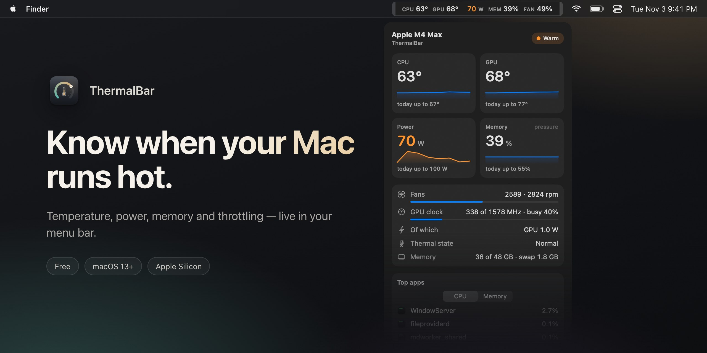

**English** · [Русский](README.ru.md) · [简体中文](README.zh-CN.md) · [Español](README.es.md) · [Türkçe](README.tr.md) · [العربية](README.ar.md) · [日本語](README.ja.md) · [Deutsch](README.de.md) · [Français](README.fr.md) · [한국어](README.ko.md)

<h3>Know when your Mac runs hot.</h3>

A free menu bar app for Apple Silicon Macs. CPU and GPU temperature, power, memory pressure, fans and throttling — live, color-coded, one glance away.

Free · macOS 13 Ventura or later · Apple Silicon M1–M5 · signed and notarized by Apple

 

---

## Why ThermalBar

A Mac does not tell you when it overheats. It just gets slower: macOS quietly lowers the clocks, the fans spin up, a game drops frames, an export takes longer. ThermalBar puts the numbers where you can always see them and says plainly when something is wrong.

- **One glance.** Numbers stay calm while everything is fine and turn orange, then red, as they climb.
- **It tells you why.** You see the moment heat starts slowing the Mac down, and when the GPU gets stuck at a low clock.
- **Native and light.** One small app. No Homebrew, no helper process, no `sudo`, no Electron, no network.

## Everything in one click

Click the numbers in the menu bar and the panel opens: temperatures with five-minute trends, today's peaks, power, memory pressure and swap, fans, GPU clock and load, the three apps loading your Mac the most, and your last game session. The panel is glass, with a transparency slider, and follows light and dark mode.

## Throttling, a stuck GPU, memory running out

- **Throttling indicator.** A small sign appears in the menu bar when macOS lowers the clocks because of heat, with a hint about what helps.
- **"GPU stuck at a low clock".** If the GPU is fully busy but runs at a fraction of its top clock and heat does not explain it, ThermalBar tells you. A restart usually fixes it.
- **Memory pressure, the way macOS sees it.** Not a misleading "RAM %", but the same green, yellow and red rating Activity Monitor uses, plus swap.
- **Notifications** for each of these, at most once every 20 minutes. Each can be turned off.

## Statistics you can export

ThermalBar keeps a minute-by-minute history on your Mac for 90 days. Pick today, 7 days, 30 days or any dates, and save a clean report with charts (HTML, opens in any browser) or a spreadsheet (CSV for Excel and Numbers). Game sessions are detected automatically, so you can see how hot your last evening of gaming really got.

## Settings, not config files

Choose what the menu bar shows, one line or two, labels and colors. Thresholds start at sensible values for your chip (base, Pro, Max or Ultra) and are yours to change. English and Russian, picked from your system language.

## Install

1. Download **[ThermalBar.zip](https://github.com/evilork/thermalbar/releases/latest/download/ThermalBar.zip)**.
2. Unzip it and drag **ThermalBar.app** to **Applications**.
3. Open it. The app is signed and notarized by Apple, so it opens without warnings.

ThermalBar opens at login by default; switch that off in **Settings → General**.

**Upgrading from 1.0?** Quit the old app and replace it with the new one. Version 2.0 turns off the old `macmon` helper by itself. `macmon` stays installed; remove it with `brew uninstall macmon` if nothing else uses it.

**Requirements:** an Apple Silicon Mac (M1 or newer) and macOS 13 Ventura or later.

## Privacy

ThermalBar only reads sensors. It never changes fan speeds, clocks or system settings, makes no network requests, and nothing leaves your Mac. The history for statistics stays in `~/Library/Application Support/ThermalBar`.

## Default thresholds

| Metric | Orange | Red | Badge |
|--------|--------|-----|-------|
| CPU and GPU temperature | 70 °C | 85 °C | 95 °C |
| Power, base chips | 15 W | 30 W | 45 W |
| Power, Pro chips | 40 W | 70 W | 90 W |
| Power, Max chips | 60 W | 100 W | 130 W |
| Power, Ultra chips | 90 W | 150 W | 200 W |
| Fans (share of top speed) | 70% | 90% | — |
| Memory | macOS yellow | — | macOS red |

## Which monitor should you pick?

ThermalBar does one job: heat. It answers two questions: “is my Mac running hot?” and “is that slowing it down?”

- **Pick ThermalBar** if you want temperature, power, memory pressure, fans and throttling explained in plain words, with alerts and a history you can export.
- **Pick Stats or iStat Menus** if you also want network, disk, battery and per-core graphs in the menu bar. Stats is free and open source, iStat Menus is paid; both cover much more ground.
- **Pick a fan control app** if you want to set fan speeds yourself. ThermalBar only reads sensors and never changes anything.

## FAQ

**How do I check the CPU temperature on a Mac?** macOS does not show it anywhere. Install ThermalBar and the CPU and GPU temperatures appear in the menu bar at once, without an admin password or Terminal.

**What temperature is normal for an Apple Silicon Mac?** Apple does not publish a limit. Under heavy load the chips often run between 80 and 100 °C, fanless MacBook Air models especially, and macOS protects the chip by lowering its clocks. So the useful question is whether the Mac is throttling, and ThermalBar shows exactly that.

**Does it need sudo or an admin password?** No. ThermalBar has no helper process and asks for no password; it reads the same sensors macOS reads for itself.

**Does ThermalBar slow down my Mac?** No. In our measurements, with the panel closed, it uses about 1% of one CPU core and about 100 MB of memory. The panel is drawn only while it is open.

**Is it free?** Yes.

**Does it work on Intel Macs?** No. The sensors work differently on Intel; ThermalBar is made for Apple Silicon.

**Why is it not on the Mac App Store?** It reads sensors through read-only system interfaces that App Store apps are not allowed to use.

**Is the GPU temperature real?** Apple Silicon has no single GPU sensor. ThermalBar averages the sensors in the GPU part of the chip, which matches what other monitors show.

**Is it open source?** Version 1.0 was. Starting with 2.0 the source code is closed; the app stays free.

**How do I uninstall it?** Turn off **Open at login** in Settings, quit ThermalBar and drag it to the Trash. To remove settings and history as well, delete `~/.config/thermalbar` and `~/Library/Application Support/ThermalBar`.

## Support

ThermalBar is free. If it earned a spot in your menu bar, a tip is hugely appreciated.

| Coin | Address |
|------|---------|
| **BTC** | `bc1pd47ssznzl6afr94zdkyk3g504h4l5m9etfg83lnwlsradg7yrrysk2wlt7` |
| **LTC** | `M9hXcyfRfaXajtzNbVV6pJwC5RoFbijfys` |
| **ETH** | `0x6e5afc8583239da03bf3fd21dd7fafe5e65e1670` |
| **SOL** | `FZ6jUxZUpzneTGgv4X7KAXmxjLrVAfksBojnw6mkEuqQ` |
| **TRON** | `TNHjSq6kc4bmt7tX5QGxd1YsGFa2XN62uQ` |
| **TON** | `UQCCFCDL7fDf6WTcEtAluxL9oAN8sKb3awjH7U752Xkzl1XI` |

Found a bug or have an idea? [Open an issue](https://github.com/evilork/thermalbar/issues).

---

**If ThermalBar is useful, star ⭐ the repo — it helps other Mac users find it.**

Keywords

ThermalBar is a free **Mac temperature monitor** and lightweight **macOS system monitor** for the **menu bar**: mac temperature monitor · cpu temperature mac · macbook temperature monitor · mac gpu temperature · free mac temperature monitor · mac temperature monitor menu bar · mac system monitor free · **istat menus alternative free** · mac overheating monitor · how to check cpu temperature on mac · mac throttling monitor · mac thermal throttling · mac gpu clock · mac fan speed menu bar · mac memory pressure menu bar · mac power draw monitor · mac wattage menu bar · apple silicon temperature monitor · M1 M2 M3 M4 M5 temperature · M4 Max temperature · macOS Ventura Sonoma Sequoia Tahoe temperature monitor · mac temperature history export

A free, native alternative to **iStat Menus**, **Stats**, **Fanny** and **Hot**, focused on temperature, power, memory pressure, fans and throttling.

