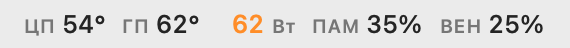
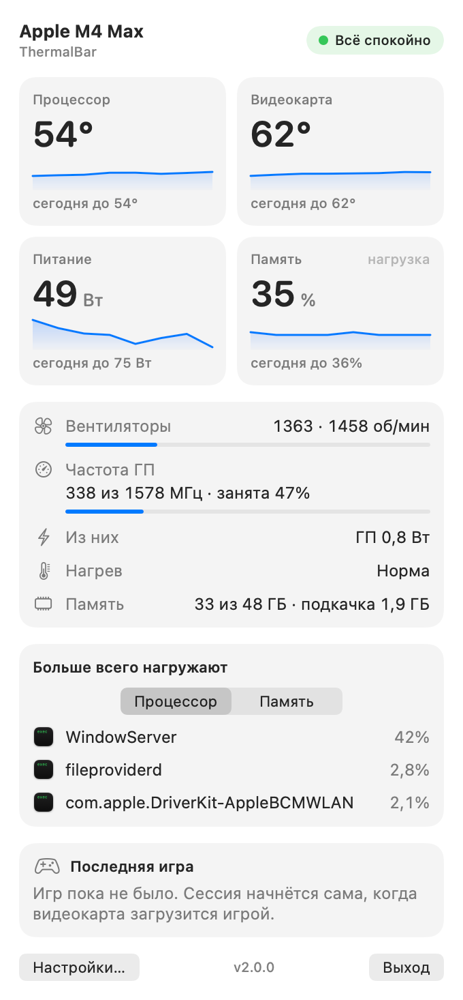

<div align="center">


# 🌡️ ThermalBar

### macOS menu bar CPU & GPU temperature monitor - native, color-coded, lightweight, free.

**A free Mac temperature monitor that lives in your menu bar.** Live CPU and GPU temperature, power draw, memory pressure and fans - color-coded, no `sudo`, no helpers, no Electron. Built for Apple Silicon (M1, M2, M3, M4, M4 Max, M5).

[](https://www.apple.com/macos/)
[](https://support.apple.com/en-us/116943)
[](https://swift.org)
[](LICENSE)
[]()

</div>

---

## Why ThermalBar?

Apple hides chip temperature behind private APIs. Most Mac temperature monitors are heavy Electron apps or need `sudo`, and a full suite like iStat Menus costs money. ThermalBar is a **tiny native Swift app** that reads the sensors directly and shows them as **color-coded numbers** in your menu bar. One click opens a panel with everything else. No dock icon, no background helpers, nothing sent anywhere.

## What's new in 2.0

- 🧩 **Zero dependencies.** No Homebrew, no `macmon`, no helper process, no `sudo`. Download, open, done.
- 🌡️ **Every sensor read natively:** CPU temperature, GPU temperature, whole-system power, GPU clock and load, CPU/GPU power where macOS reports it, and fan speed.
- 🧠 **Memory pressure like Activity Monitor.** Colored by macOS's own rating (normal / yellow / red), with used memory and swap in the panel.
- 🔥 **Throttling indicator.** Shows when macOS lowers clocks because of heat, with a hint what to do.
- 🎮 **"GPU stuck at a low clock" detection.** If the GPU is fully busy but stuck at a fraction of its top clock (and heat does not explain it), ThermalBar tells you - a restart usually fixes it.
- 📈 **Today's peaks and your last game session** (duration, peak temperatures and power, how long the Mac throttled) instead of an all-time average.
- 🧮 **Top apps** loading your Mac, by CPU or by memory.
- ⚙️ **A real Settings window** instead of editing JSON: menu bar items, layout, colors, thresholds, notifications, refresh rate.
- 🔔 **Notifications** when memory runs out, the Mac throttles, or the GPU gets stuck (each at most every 20 minutes).
- 🌍 **Russian and English**, picked from your system language (or set it by hand).
- 🪟 **Glass panel with a transparency slider**, follows light and dark mode.
- 📏 **Single-line or two-line menu bar layout**, numbers neutral until they need attention (or always colored, like 1.x).
- ✅ **Runs on macOS 13 Ventura and later** - fixes [#2](https://github.com/evilork/thermalbar/issues/2) (1.0 required macOS 26).

## Screenshots

<p align="center">
  <picture>
    <source media="(prefers-color-scheme: dark)" srcset="docs/menubar-dark.png">
    
  </picture><br><br>
  <picture>
    <source media="(prefers-color-scheme: dark)" srcset="docs/panel-dark.png">
    
  </picture>
</p>

## Install

1. Download **`ThermalBar-2.0.0.zip`** from [Releases](https://github.com/evilork/thermalbar/releases/latest).
2. Unzip it and move **ThermalBar.app** to **Applications**.
3. Open it. The release build is signed and notarized by Apple, so it opens like any other app.

ThermalBar asks once whether it may send notifications. It opens at login by default; switch that off in **Settings → General**.

### Build from source

```bash
git clone https://github.com/evilork/thermalbar.git
cd thermalbar
./install.sh
```

The installer builds the app, puts it in `/Applications`, sets it to open at login and starts it. It needs the [Xcode Command Line Tools](https://developer.apple.com/xcode/resources/) (`xcode-select --install`). Upgrading from 1.x: the installer also removes the old `com.evilork.macmon` helper agent (the `macmon` program itself is left installed).

### Requirements

- Apple Silicon Mac (M1-M5)
- macOS 13 Ventura or later

## Using it

- **Menu bar:** CPU and GPU temperature, power in watts, memory pressure and, optionally, fan speed. Numbers stay neutral while everything is fine, turn orange and red as they climb, and get a red badge at the critical threshold. A small warning sign appears when the Mac throttles, the GPU is stuck, or memory is critical.
- **Panel (click):** status, tiles with five-minute trends and today's peaks, fans, GPU clock and load, thermal state, memory and swap, top apps, last game, Settings and Quit.
- **Game sessions** start by themselves when a known game (or anything that keeps the GPU busy for a minute) is in front, and end when it quits or goes idle for two minutes.

### Default thresholds

| Metric | Orange | Red | Badge |
|--------|--------|-----|-------|
| CPU / GPU temperature | 70 °C | 85 °C | 95 °C |
| Power, base chips | 15 W | 30 W | 45 W |
| Power, Pro chips | 40 W | 70 W | 90 W |
| Power, Max chips | 60 W | 100 W | 130 W |
| Power, Ultra chips | 90 W | 150 W | 200 W |
| Fans (share of max speed) | 70% | 90% | - |
| Memory | macOS yellow | - | macOS red |

Change them in **Settings → Thresholds**; "Reset" brings back the values for your chip.

### Files

| Path | What |
|------|------|
| `~/.config/thermalbar/config.json` | settings (written by the Settings window; a 1.x file is migrated automatically) |
| `~/Library/Application Support/ThermalBar/state.json` | today's peaks and the last game session |
| `~/Library/LaunchAgents/com.evilork.thermalbar.plist` | open at login (the Settings switch adds and removes it) |

## How it works

ThermalBar only **reads**; it never changes fan speeds, clocks or any system setting, makes no network requests, and no data leaves your Mac.

- **CPU temperature** - die sensors through IOKit's HID event system (`PMU tdie*`), the source `powermetrics` uses.
- **GPU temperature, system power, fans** - read-only keys of the System Management Controller (`Tg*` GPU sensors averaged, `PSTR` total power, `F*Ac` / `F*Mx` fan speeds).
- **GPU clock, GPU load, CPU/GPU power** - IOReport performance-state residencies weighted by the chip's own frequency table, plus its energy counters.
- **Memory and thermal state** - `host_statistics64`, `vm.swapusage`, `kern.memorystatus_*` and the `com.apple.system.thermalpressurelevel` notification.
- **Top apps** - `/bin/ps` (process id, CPU, memory, executable path only) plus each process's memory footprint.

> **Note:** some newer macOS versions report zero CPU energy on some chips; ThermalBar then simply hides the CPU power figure.

## Uninstall

Quit ThermalBar and drag it to the Trash, or from a clone run:

```bash
./uninstall.sh
```

It removes the app, the login agent (and the 1.x helper agent), settings and saved history.

## Building

```bash
./build.sh          # build/ThermalBar.app (arm64, macOS 13+, ad-hoc signed)
./build.sh test     # unit tests
./build.sh zip      # build/ThermalBar-<version>.zip + .sha256
./build.sh clean
```

For maintainers: `SIGN_IDENTITY="Developer ID Application: …"` signs with the hardened runtime; with `NOTARY_PROFILE=<notarytool keychain profile>` as well, `./build.sh zip` notarizes and staples the build. The script fails if the binary would require a newer macOS than 13.0.

## FAQ

**Why private APIs?** Apple offers no public API for chip temperatures, GPU clocks or fan speeds. ThermalBar uses the same read-only interfaces as Apple's own tools; that is also why it cannot be on the Mac App Store.

**Intel Macs?** Not supported: the sensors work differently on Intel. ThermalBar targets Apple Silicon only.

**Is the GPU temperature real?** Apple Silicon has no single GPU sensor; ThermalBar averages the GPU-region sensors of the chip, which matches what other monitors report.

## Support / Donate

ThermalBar is free and open source. If it earned a spot in your menu bar, a tip is hugely appreciated 🙏

| Coin | Address |
|------|---------|
| **BTC** | `bc1pd47ssznzl6afr94zdkyk3g504h4l5m9etfg83lnwlsradg7yrrysk2wlt7` |
| **LTC** | `M9hXcyfRfaXajtzNbVV6pJwC5RoFbijfys` |
| **ETH** | `0x6e5afc8583239da03bf3fd21dd7fafe5e65e1670` |
| **SOL** | `FZ6jUxZUpzneTGgv4X7KAXmxjLrVAfksBojnw6mkEuqQ` |
| **TRON** | `TNHjSq6kc4bmt7tX5QGxd1YsGFa2XN62uQ` |
| **TON** | `UQCCFCDL7fDf6WTcEtAluxL9oAN8sKb3awjH7U752Xkzl1XI` |

## License

[MIT](LICENSE) © evilork

---

<div align="center">
<sub>Built for Apple Silicon. Star ⭐ if it's useful - it helps others find it.</sub>
</div>

---

<details>
<summary><sub>Keywords & related searches</sub></summary>

<sub>

ThermalBar is a free, open-source **Mac temperature monitor** and lightweight **macOS system monitor** that lives in the **menu bar**. If you searched for any of the following, this is the tool:

**mac temperature monitor** · **cpu temperature mac** · **mac cpu temp** · **macbook temperature monitor** · **mac cpu temperature** · free mac temperature monitor · mac temperature monitor menu bar · monitor mac cpu gpu temperature · mac system monitor free · **istat menus alternative free** · mac temperature widget · mac overheating monitor · how to check cpu temperature on mac · mac menu bar cpu temp · lightweight mac temperature monitor · mac thermal monitor · mac throttling monitor · mac gpu clock · mac fan speed menu bar · mac memory pressure menu bar · mac die temperature · mac sensors temperature · **mac temp monitor github** · free mac cpu temp monitor · free alternative to istat menus temperature · best free mac temperature monitor 2026 · mac gpu temperature monitor · apple silicon temperature monitor · M1 M2 M3 M4 M5 temperature monitor · M4 Max temperature monitor · mac power draw monitor · mac wattage menu bar · macOS Ventura Sonoma Sequoia temperature monitor

A free, native alternative to **iStat Menus**, **Stats**, **Fanny**, and **Hot** - focused on CPU & GPU temperature, power, memory pressure and fans, right in the menu bar.

</sub>

</details>
