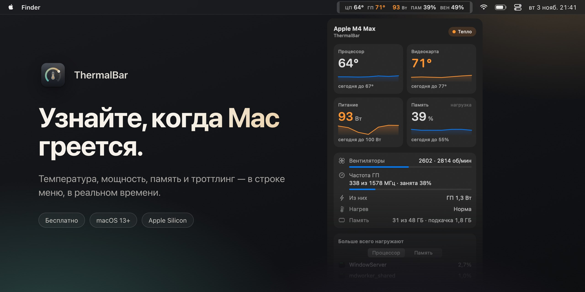
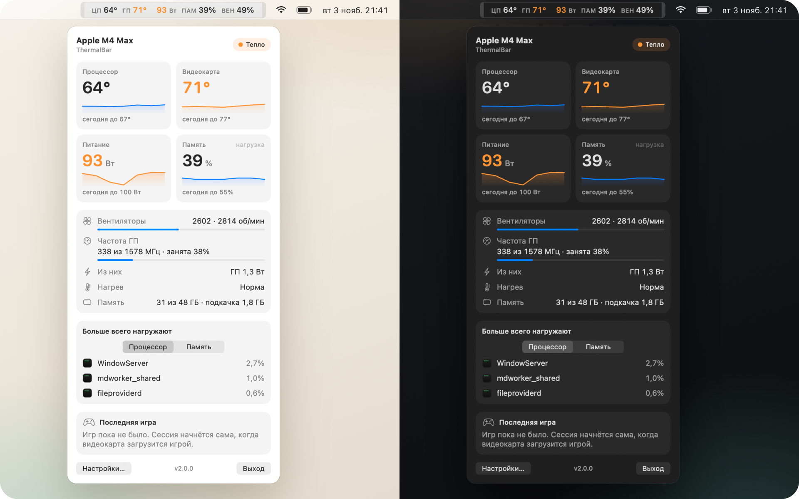
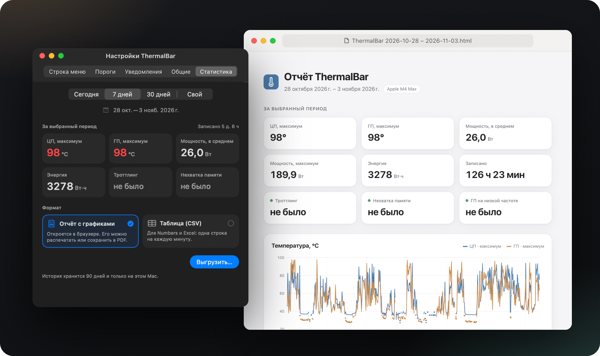
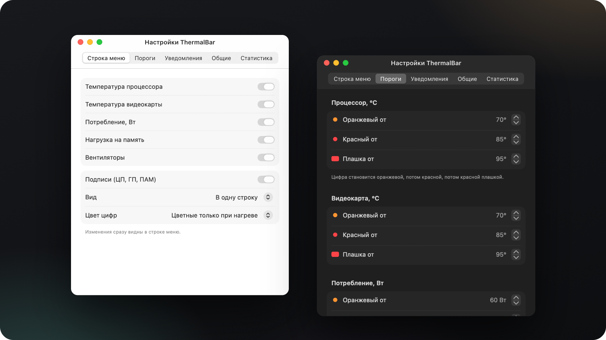

[English](README.md) · **Русский** · [简体中文](README.zh-CN.md) · [Español](README.es.md) · [Türkçe](README.tr.md) · [العربية](README.ar.md) · [日本語](README.ja.md) · [Deutsch](README.de.md) · [Français](README.fr.md) · [한국어](README.ko.md)

<h3>Узнайте, когда Mac греется.</h3>

Бесплатное приложение для строки меню на Mac с Apple Silicon. Температура процессора и графики, мощность, нагрузка на память, вентиляторы и троттлинг — в реальном времени, с цветовой подсветкой, одним взглядом.

Бесплатно · macOS 13 Ventura и новее · Apple Silicon M1–M5 · подписано и нотаризовано Apple

 

---

## Зачем нужен ThermalBar

Mac не сообщает, что перегрелся. Он просто начинает работать медленнее: macOS тихо снижает частоты, вентиляторы раскручиваются, в игре падает частота кадров, экспорт идёт дольше. ThermalBar выводит цифры туда, где их всегда видно, и прямо говорит, когда что-то не так.

- **Одного взгляда достаточно.** Пока всё в порядке, цифры спокойные; по мере роста они становятся оранжевыми, потом красными.
- **Он объясняет причину.** Вы видите момент, когда жара начинает тормозить Mac, и когда графический процессор застревает на низкой частоте.
- **Родное и лёгкое.** Одно небольшое приложение. Без Homebrew, без вспомогательного процесса, без `sudo`, без Electron, без сети.

## Всё в один клик

Нажмите на цифры в строке меню, и откроется панель: температуры с трендом за пять минут, пики за сегодня, мощность, нагрузка на память и своп, вентиляторы, частота и загрузка графического процессора, три приложения, которые больше всего нагружают Mac, и ваша последняя игровая сессия. Панель стеклянная, с ползунком прозрачности, и подстраивается под светлую и тёмную тему.

## Троттлинг, застрявший GPU, нехватка памяти

- **Индикатор троттлинга.** Когда macOS снижает частоты из-за перегрева, в строке меню появляется небольшой значок с подсказкой, что поможет.
- **«GPU застрял на низкой частоте».** Если графический процессор загружен полностью, но работает на малой доле максимальной частоты, и жара этого не объясняет, ThermalBar скажет об этом. Обычно помогает перезагрузка.
- **Нагрузка на память — так, как её видит macOS.** Не вводящие в заблуждение «% ОЗУ», а та же зелёная, жёлтая и красная оценка, что и в приложении «Мониторинг системы», плюс своп.
- **Уведомления** по каждому из этих пунктов, не чаще раза в 20 минут. Любое можно отключить.

## Статистика, которую можно выгрузить

ThermalBar хранит историю с точностью до минуты на вашем Mac в течение 90 дней. Выберите сегодня, 7 дней, 30 дней или любые даты и сохраните аккуратный отчёт с графиками (HTML, открывается в любом браузере) или таблицу (CSV для Excel и Numbers). Игровые сессии определяются автоматически, так что видно, насколько нагрелся Mac за последний игровой вечер.

## Настройки, а не файлы конфигурации

Выберите, что показывать в строке меню, одну строку или две, подписи и цвета. Пороги по умолчанию подобраны под ваш чип (базовый, Pro, Max или Ultra), и их можно менять. Русский и английский, язык выбирается по языку системы.

## Установка

1. Скачайте **[ThermalBar.zip](https://github.com/evilork/thermalbar/releases/latest/download/ThermalBar.zip)**.
2. Распакуйте архив и перетащите **ThermalBar.app** в **Программы**.
3. Откройте приложение. Оно подписано и нотаризовано Apple, поэтому открывается без предупреждений.

ThermalBar по умолчанию открывается при входе в систему; отключить это можно в **Настройки → Общие**.

**Обновляетесь с 1.0?** Закройте старое приложение и замените его новым. Версия 2.0 сама отключает прежний вспомогательный `macmon`. Сам `macmon` остаётся установленным; если он больше никому не нужен, удалите его командой `brew uninstall macmon`.

**Требования:** Mac с Apple Silicon (M1 или новее) и macOS 13 Ventura или новее.

## Конфиденциальность

ThermalBar только читает датчики. Он никогда не меняет скорость вентиляторов, частоты и системные настройки, не делает сетевых запросов, и ничто не покидает ваш Mac. История для статистики хранится в `~/Library/Application Support/ThermalBar`.

## Пороги по умолчанию

| Показатель | Оранжевый | Красный | Значок |
|------------|-----------|---------|--------|
| Температура процессора и графики | 70 °C | 85 °C | 95 °C |
| Мощность, базовые чипы | 15 Вт | 30 Вт | 45 Вт |
| Мощность, чипы Pro | 40 Вт | 70 Вт | 90 Вт |
| Мощность, чипы Max | 60 Вт | 100 Вт | 130 Вт |
| Мощность, чипы Ultra | 90 Вт | 150 Вт | 200 Вт |
| Вентиляторы (доля от максимальной скорости) | 70% | 90% | — |
| Память | жёлтый в macOS | — | красный в macOS |

## Какой монитор выбрать

ThermalBar делает одно дело — следит за нагревом. Он отвечает на два вопроса: «не перегревается ли Mac?» и «не тормозит ли он из-за этого?»

- **Выбирайте ThermalBar**, если нужны температура, мощность, нагрузка на память, вентиляторы и троттлинг простыми словами, с уведомлениями и историей, которую можно выгрузить.
- **Выбирайте Stats или iStat Menus**, если в строке меню нужны ещё сеть, диск, батарея и графики по ядрам. Stats бесплатный и с открытым кодом, iStat Menus платный; оба умеют гораздо больше.
- **Выбирайте программу управления вентиляторами**, если хотите сами задавать их скорость. ThermalBar только читает датчики и ничего не меняет.

## Вопросы и ответы

**Как посмотреть температуру процессора на Mac?** Сама macOS её нигде не показывает. Установите ThermalBar — температура процессора и GPU сразу появится в строке меню, без пароля администратора и Терминала.

**Какая температура нормальна для Mac на Apple Silicon?** Apple не публикует предел. Под тяжёлой нагрузкой чипы часто работают при 80–100 °C, особенно MacBook Air без вентилятора, и macOS защищает чип, снижая частоты. Поэтому важнее понять, не начался ли троттлинг, — ThermalBar показывает именно это.

**Нужны ли sudo или пароль администратора?** Нет. У ThermalBar нет вспомогательного процесса, и он не просит пароль: он читает те же датчики, что и сама macOS.

**ThermalBar не тормозит Mac?** Нет. По нашим замерам, пока панель закрыта, он занимает около 1 % одного ядра процессора и около 100 МБ памяти. Панель рисуется, только пока она открыта.

**Это бесплатно?** Да.

**Работает ли на Mac с Intel?** Нет. У Intel датчики устроены иначе; ThermalBar сделан для Apple Silicon.

**Почему его нет в Mac App Store?** Он читает датчики через системные интерфейсы только для чтения, которые приложениям из App Store использовать нельзя.

**Настоящая ли температура графики?** В Apple Silicon нет единого датчика GPU. ThermalBar усредняет показания датчиков в графической части чипа, и это совпадает с тем, что показывают другие мониторы.

**Есть ли открытый код?** В версии 1.0 был. Начиная с 2.0 исходный код закрыт; приложение остаётся бесплатным.

**Как удалить?** Отключите **Открывать при входе** в настройках, закройте ThermalBar и перетащите его в Корзину. Чтобы убрать и настройки с историей, удалите `~/.config/thermalbar` и `~/Library/Application Support/ThermalBar`.

## Поддержка

ThermalBar бесплатен. Если он заслужил место в вашей строке меню, будем очень благодарны за чаевые.

| Монета | Адрес |
|--------|-------|
| **BTC** | `bc1pd47ssznzl6afr94zdkyk3g504h4l5m9etfg83lnwlsradg7yrrysk2wlt7` |
| **LTC** | `M9hXcyfRfaXajtzNbVV6pJwC5RoFbijfys` |
| **ETH** | `0x6e5afc8583239da03bf3fd21dd7fafe5e65e1670` |
| **SOL** | `FZ6jUxZUpzneTGgv4X7KAXmxjLrVAfksBojnw6mkEuqQ` |
| **TRON** | `TNHjSq6kc4bmt7tX5QGxd1YsGFa2XN62uQ` |
| **TON** | `UQCCFCDL7fDf6WTcEtAluxL9oAN8sKb3awjH7U752Xkzl1XI` |

Нашли ошибку или есть идея? [Создайте обсуждение](https://github.com/evilork/thermalbar/issues).

---

**Если ThermalBar пригодился, поставьте репозиторию звезду ⭐ — так его найдут другие пользователи Mac.**

Ключевые слова

ThermalBar — бесплатный **монитор температуры Mac** и лёгкий **системный монитор для macOS** в **строке меню**: температура процессора мак · как узнать температуру мака · температура макбука · температура видеокарты мак · монитор температуры мак бесплатно · температура в строке меню мак · мониторинг системы мак · **аналог iStat Menus бесплатно** · перегрев макбука · как проверить температуру процессора на маке · троттлинг макбук · тепловой троттлинг мак · частота GPU мак · скорость вентиляторов мак · нагрузка на память мак · потребление мак в ваттах · температура Apple Silicon · температура M1 M2 M3 M4 M5 · температура M4 Max · mac temperature monitor · cpu temperature mac · istat menus alternative free · mac throttling monitor · apple silicon temperature monitor

Бесплатная нативная альтернатива **iStat Menus**, **Stats**, **Fanny** и **Hot**, сосредоточенная на температуре, мощности, нагрузке на память, вентиляторах и троттлинге.

