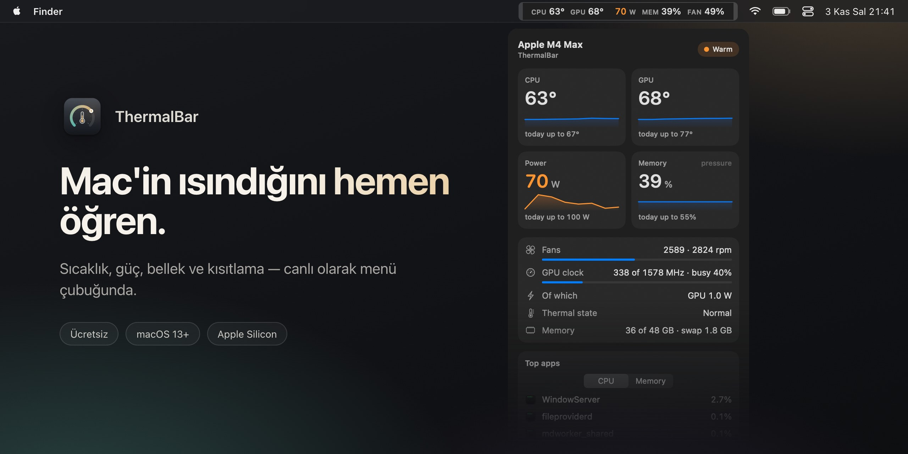
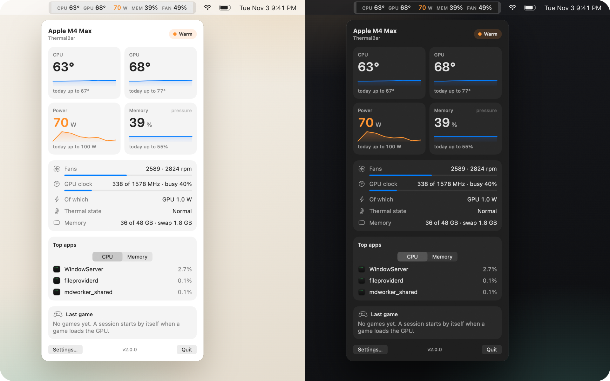
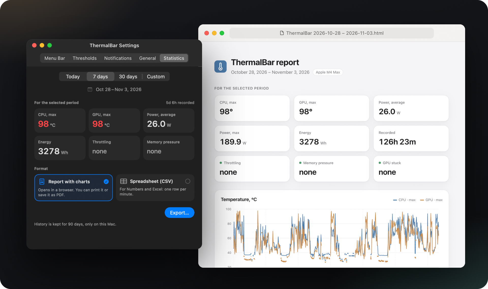
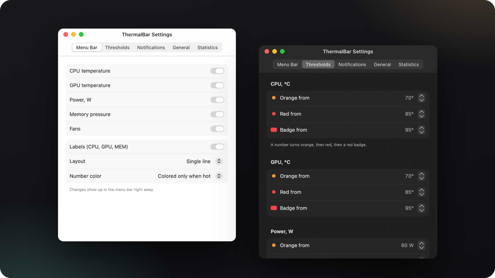

[English](README.md) · [Русский](README.ru.md) · [简体中文](README.zh-CN.md) · [Español](README.es.md) · **Türkçe** · [العربية](README.ar.md) · [日本語](README.ja.md) · [Deutsch](README.de.md) · [Français](README.fr.md) · [한국어](README.ko.md)

<h3>Mac'in ısındığını hemen öğren.</h3>

Apple Silicon'lu Mac'ler için ücretsiz bir menü çubuğu uygulaması. CPU ve GPU sıcaklığı, güç, bellek baskısı, fanlar ve kısıtlama (throttling) — canlı, renk kodlu, tek bakışta.

Ücretsiz · macOS 13 Ventura veya üzeri · Apple Silicon M1–M5 · Apple tarafından imzalanmış ve noter onaylı

 

---

## Neden ThermalBar

Mac, aşırı ısındığında bunu söylemez. Sadece yavaşlar: macOS saat hızlarını sessizce düşürür, fanlar hızlanır, oyunda kare hızı düşer, dışa aktarma uzar. ThermalBar rakamları her zaman görebileceğiniz yere koyar ve bir şey ters gittiğinde açıkça söyler.

- **Tek bakış.** Her şey yolundayken rakamlar sakin kalır, yükseldikçe turuncuya, sonra kırmızıya döner.
- **Nedenini söyler.** Isının Mac'i yavaşlatmaya başladığı anı ve GPU'nun düşük bir saat hızında takılıp kaldığı anı görürsünüz.
- **Yerel ve hafif.** Tek, küçük bir uygulama. Homebrew yok, yardımcı süreç yok, `sudo` yok, Electron yok, ağ yok.

## Her şey tek tıkta

Menü çubuğundaki rakamlara tıklayın, panel açılır: beş dakikalık eğilimlerle sıcaklıklar, bugünün zirveleri, güç, bellek baskısı ve swap, fanlar, GPU saat hızı ve yükü, Mac'inizi en çok yoran üç uygulama ve son oyun oturumunuz. Panel camsı bir görünümdedir, saydamlık kaydırıcısı vardır ve açık ile koyu modu takip eder.

## Kısıtlama, takılan GPU, tükenen bellek

- **Kısıtlama göstergesi.** macOS ısı yüzünden saat hızlarını düşürdüğünde menü çubuğunda küçük bir işaret belirir; neyin işe yarayacağına dair bir ipucu da verir.
- **"GPU düşük saat hızında takıldı".** GPU tamamen meşgulken en yüksek saat hızının yalnızca bir kısmında çalışıyorsa ve bunu ısı açıklamıyorsa ThermalBar size söyler. Yeniden başlatmak genellikle sorunu çözer.
- **Bellek baskısı, macOS'in gördüğü şekliyle.** Yanıltıcı bir "RAM %" değil, Etkinlik Monitörü'nün kullandığı aynı yeşil, sarı ve kırmızı derecelendirme; ayrıca swap.
- **Bildirimler**, bunların her biri için en fazla 20 dakikada bir gelir. Her biri kapatılabilir.

## Dışa aktarabileceğiniz istatistikler

ThermalBar, Mac'inizde 90 gün boyunca dakika dakika geçmiş tutar. Bugünü, 7 günü, 30 günü ya da istediğiniz tarihleri seçin; grafikli temiz bir rapor (HTML, her tarayıcıda açılır) veya bir elektronik tablo (Excel ve Numbers için CSV) kaydedin. Oyun oturumları otomatik algılanır; böylece son oyun akşamınızın gerçekte ne kadar ısındığını görebilirsiniz.

## Yapılandırma dosyaları değil, ayarlar

Menü çubuğunun neyi göstereceğini, tek satır mı iki satır mı olacağını, etiketleri ve renkleri siz seçersiniz. Eşik değerleri çipinize (temel, Pro, Max veya Ultra) uygun makul değerlerle başlar ve değiştirmek size kalmış. İngilizce ve Rusça, sistem dilinize göre seçilir.

## Kurulum

1. **[ThermalBar.zip](https://github.com/evilork/thermalbar/releases/latest/download/ThermalBar.zip)** dosyasını indirin.
2. Arşivi açın ve **ThermalBar.app**'i **Uygulamalar**'a sürükleyin.
3. Açın. Uygulama Apple tarafından imzalanmış ve noter onaylıdır; bu yüzden uyarı vermeden açılır.

ThermalBar varsayılan olarak oturum açıldığında başlar; bunu **Ayarlar → Genel (Settings → General)** bölümünden kapatabilirsiniz.

**1.0'dan mı geçiyorsunuz?** Eski uygulamadan çıkın ve yenisiyle değiştirin. 2.0 sürümü eski `macmon` yardımcısını kendiliğinden kapatır. `macmon` kurulu kalır; başka bir şey kullanmıyorsa `brew uninstall macmon` ile kaldırabilirsiniz.

**Gereksinimler:** Apple Silicon'lu bir Mac (M1 veya daha yenisi) ve macOS 13 Ventura veya üzeri.

## Gizlilik

ThermalBar yalnızca sensörleri okur. Fan hızlarını, saat hızlarını veya sistem ayarlarını asla değiştirmez, ağ isteği yapmaz ve Mac'inizden hiçbir şey dışarı çıkmaz. İstatistikler için tutulan geçmiş `~/Library/Application Support/ThermalBar` içinde kalır.

## Varsayılan eşik değerleri

| Ölçüm | Turuncu | Kırmızı | Rozet |
|-------|---------|---------|-------|
| CPU ve GPU sıcaklığı | 70 °C | 85 °C | 95 °C |
| Güç, temel çipler | 15 W | 30 W | 45 W |
| Güç, Pro çipler | 40 W | 70 W | 90 W |
| Güç, Max çipler | 60 W | 100 W | 130 W |
| Güç, Ultra çipler | 90 W | 150 W | 200 W |
| Fanlar (en yüksek hızın yüzdesi) | %70 | %90 | — |
| Bellek | macOS sarısı | — | macOS kırmızısı |

## Hangi monitörü seçmeli?

ThermalBar tek bir iş yapar: ısıyı izler. İki soruyu yanıtlar: "Mac'im aşırı mı ısınıyor?" ve "Bu yüzden yavaşlıyor mu?"

- **ThermalBar'ı seçin**: sıcaklık, güç, bellek baskısı, fanlar ve kısıtlamayı sade bir dille, bildirimlerle ve dışa aktarılabilen bir geçmişle görmek istiyorsanız.
- **Stats'i veya iStat Menus'ü seçin**: menü çubuğunda ağ, disk, pil ve çekirdek başına grafikler de istiyorsanız. Stats ücretsiz ve açık kaynaklıdır, iStat Menus ücretlidir; ikisi de çok daha geniş bir alanı kapsar.
- **Bir fan kontrol uygulaması seçin**: fan hızlarını kendiniz ayarlamak istiyorsanız. ThermalBar yalnızca sensörleri okur ve hiçbir şeyi değiştirmez.

## SSS

**Mac'te CPU sıcaklığı nasıl görülür?** macOS bunu hiçbir yerde göstermez. ThermalBar'ı yükleyin; CPU ve GPU sıcaklıkları yönetici parolası ya da Terminal gerekmeden hemen menü çubuğunda görünür.

**Apple Silicon bir Mac için normal sıcaklık nedir?** Apple bir sınır yayımlamaz. Ağır yük altında çipler çoğu zaman 80 ile 100 °C arasında çalışır, özellikle fansız MacBook Air modellerinde; macOS da saat hızlarını düşürerek çipi korur. Bu yüzden asıl önemli olan Mac'in kısıtlamaya girip girmediğidir ve ThermalBar tam olarak bunu gösterir.

**sudo veya yönetici parolası gerekir mi?** Hayır. ThermalBar'ın yardımcı süreci yoktur ve parola istemez; macOS'in kendisinin okuduğu sensörlerin aynısını okur.

**ThermalBar Mac'i yavaşlatır mı?** Hayır. Ölçümlerimize göre panel kapalıyken bir CPU çekirdeğinin yaklaşık %1'ini ve yaklaşık 100 MB bellek kullanır. Panel yalnızca açıkken çizilir.

**Ücretsiz mi?** Evet.

**Intel'li Mac'lerde çalışır mı?** Hayır. Sensörler Intel'de farklı çalışır; ThermalBar Apple Silicon için yapıldı.

**Neden Mac App Store'da yok?** Sensörleri, App Store uygulamalarının kullanmasına izin verilmeyen, salt okunur sistem arayüzleri üzerinden okur.

**GPU sıcaklığı gerçek mi?** Apple Silicon'da tek bir GPU sensörü yoktur. ThermalBar, çipin GPU bölümündeki sensörlerin ortalamasını alır; bu, diğer monitörlerin gösterdiğiyle örtüşür.

**Açık kaynak mı?** 1.0 sürümü öyleydi. 2.0'dan itibaren kaynak kod kapalı; uygulama ücretsiz kalıyor.

**Nasıl kaldırırım?** Ayarlarda **Oturum açıldığında aç (Open at login)** seçeneğini kapatın, ThermalBar'dan çıkın ve Çöp Sepeti'ne sürükleyin. Ayarları ve geçmişi de silmek için `~/.config/thermalbar` ve `~/Library/Application Support/ThermalBar` klasörlerini silin.

## Destek

ThermalBar ücretsizdir. Menü çubuğunuzda yer hak ettiyse bahşiş bırakmanız çok makbule geçer.

| Coin | Adres |
|------|-------|
| **BTC** | `bc1pd47ssznzl6afr94zdkyk3g504h4l5m9etfg83lnwlsradg7yrrysk2wlt7` |
| **LTC** | `M9hXcyfRfaXajtzNbVV6pJwC5RoFbijfys` |
| **ETH** | `0x6e5afc8583239da03bf3fd21dd7fafe5e65e1670` |
| **SOL** | `FZ6jUxZUpzneTGgv4X7KAXmxjLrVAfksBojnw6mkEuqQ` |
| **TRON** | `TNHjSq6kc4bmt7tX5QGxd1YsGFa2XN62uQ` |
| **TON** | `UQCCFCDL7fDf6WTcEtAluxL9oAN8sKb3awjH7U752Xkzl1XI` |

Bir hata mı buldunuz ya da bir fikriniz mi var? [Bir issue açın](https://github.com/evilork/thermalbar/issues).

---

**ThermalBar işinize yaradıysa depoya yıldız ⭐ verin; diğer Mac kullanıcılarının onu bulmasına yardımcı olur.**

Anahtar kelimeler

ThermalBar, **menü çubuğu** için ücretsiz bir **Mac sıcaklık monitörü** ve hafif bir **macOS sistem monitörüdür**: mac sıcaklık göstergesi · mac işlemci sıcaklığı · macbook sıcaklık ölçer · mac gpu sıcaklığı · ücretsiz mac sıcaklık programı · menü çubuğunda sıcaklık gösterme mac · mac sistem monitörü ücretsiz · **ücretsiz iStat Menus alternatifi** · macbook aşırı ısınma · mac işlemci sıcaklığı nasıl görülür · mac sıcaklığı nasıl öğrenilir · macbook throttling · mac termal kısıtlama · mac fan hızı · mac bellek baskısı · mac watt tüketimi · Apple Silicon sıcaklık · M1 M2 M3 M4 M5 sıcaklık · M4 Max sıcaklık · mac temperature monitor · cpu temperature mac · istat menus alternative free · mac throttling monitor · apple silicon temperature monitor

**iStat Menus**, **Stats**, **Fanny** ve **Hot**'a sıcaklığa, güce, bellek baskısına, fanlara ve kısıtlamaya odaklanan ücretsiz, yerel bir alternatif.

