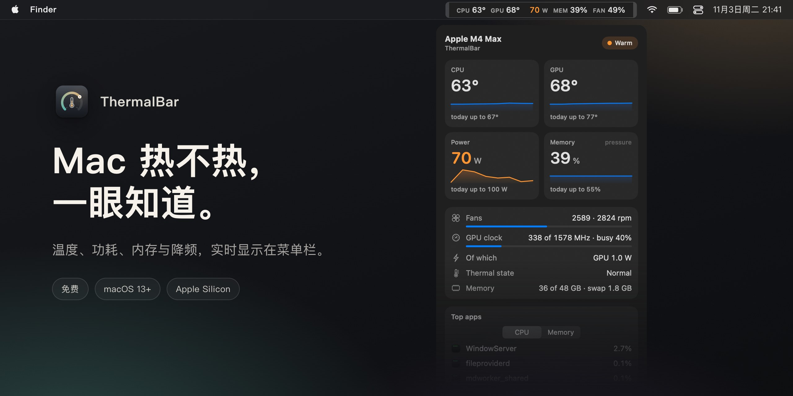

[English](README.md) · [Русский](README.ru.md) · **简体中文** · [Español](README.es.md) · [Türkçe](README.tr.md) · [العربية](README.ar.md) · [日本語](README.ja.md) · [Deutsch](README.de.md) · [Français](README.fr.md) · [한국어](README.ko.md)

<h3>Mac 热不热，一眼知道。</h3>

一款免费的 Apple Silicon Mac 菜单栏应用。CPU 和 GPU 温度、功耗、内存压力、风扇与降频状态，实时显示，颜色分级，抬眼就能看到。

免费 · macOS 13 Ventura 或更高版本 · Apple Silicon M1–M5 · 已由 Apple 签名并公证

 

---

## 为什么选择 ThermalBar

Mac 过热时不会提醒你，它只会变慢：macOS 悄悄降低频率，风扇转得更响，游戏掉帧，导出变久。ThermalBar 把这些数字放在你随时能看到的地方，出了问题也会直接告诉你。

- **一眼看懂。** 一切正常时数字保持平静，随着升高先变橙色，再变红色。
- **告诉你原因。** 你能看到发热开始拖慢 Mac 的那一刻，也能看到 GPU 卡在低频率的情况。
- **原生又轻巧。** 只有一个小应用。不需要 Homebrew，没有辅助进程，不用 `sudo`，没有 Electron，不联网。

## 一键查看全部

点击菜单栏中的数字即可打开面板：带五分钟趋势的温度、今日峰值、功耗、内存压力与交换、风扇、GPU 频率与负载、最占用 Mac 资源的三个应用，以及你最近一次的游戏记录。面板为玻璃质感，带透明度滑块，并跟随浅色与深色模式。

## 降频、GPU 卡频、内存告急

- **降频提示。** 当 macOS 因发热而降低频率时，菜单栏会出现一个小标记，并附上缓解建议。
- **“GPU 卡在低频率”。** 如果 GPU 满载却只跑在最高频率的一小部分，而且发热无法解释，ThermalBar 会告诉你。通常重启即可解决。
- **内存压力，按 macOS 的方式呈现。** 不是容易误导人的“内存百分比”，而是与“活动监视器”相同的绿、黄、红评级，外加交换。
- **通知** 覆盖以上每一项，每 20 分钟最多一次。每项都可以单独关闭。

## 可导出的统计

ThermalBar 在你的 Mac 上按分钟保存 90 天的历史记录。选择今天、7 天、30 天或任意日期，即可保存带图表的简洁报告（HTML，任何浏览器都能打开）或电子表格（CSV，适用于 Excel 和 Numbers）。游戏会话会被自动识别，所以你能看到上一个游戏夜晚 Mac 到底有多热。

## 在设置里调，不用改配置文件

自选菜单栏显示的内容、一行或两行、标签和颜色。阈值会根据你的芯片（基础版、Pro、Max 或 Ultra）给出合理的初始值，也可以随意修改。支持英文和俄文，按系统语言自动选择。

## 安装

1. 下载 **[ThermalBar.zip](https://github.com/evilork/thermalbar/releases/latest/download/ThermalBar.zip)**。
2. 解压后，把 **ThermalBar.app** 拖到“应用程序”文件夹。
3. 打开它。应用已由 Apple 签名并公证，打开时不会有任何警告。

ThermalBar 默认开机登录时自动打开；可在 **设置 → 通用（Settings → General）** 中关闭。

**从 1.0 升级？** 退出旧版应用，用新版替换即可。2.0 版本会自动停用旧的 `macmon` 辅助程序。`macmon` 仍保留在系统中；如果没有其他程序在用，可以用 `brew uninstall macmon` 删除。

**系统要求：** Apple Silicon Mac（M1 或更新）和 macOS 13 Ventura 或更高版本。

## 隐私

ThermalBar 只读取传感器。它从不更改风扇转速、频率或系统设置，不发起任何网络请求，任何数据都不会离开你的 Mac。统计用的历史记录保存在 `~/Library/Application Support/ThermalBar`。

## 默认阈值

| 指标 | 橙色 | 红色 | 角标 |
|------|------|------|------|
| CPU 和 GPU 温度 | 70 °C | 85 °C | 95 °C |
| 功耗，基础版芯片 | 15 W | 30 W | 45 W |
| 功耗，Pro 芯片 | 40 W | 70 W | 90 W |
| 功耗，Max 芯片 | 60 W | 100 W | 130 W |
| 功耗，Ultra 芯片 | 90 W | 150 W | 200 W |
| 风扇（占最高转速的比例） | 70% | 90% | — |
| 内存 | macOS 黄色 | — | macOS 红色 |

## 该选哪款监控工具？

ThermalBar 只做一件事：盯住温度。它回答两个问题：“我的 Mac 是不是太热了？”以及“它是不是因此变慢了？”

- **选 ThermalBar**：如果你想用直白的话看懂温度、功耗、内存压力、风扇和降频，并且需要提醒和可导出的历史记录。
- **选 Stats 或 iStat Menus**：如果你还想在菜单栏看网络、磁盘、电池和每个核心的图表。Stats 免费开源，iStat Menus 需要付费，两者覆盖的范围都大得多。
- **选风扇控制软件**：如果你想自己设定风扇转速。ThermalBar 只读取传感器，从不更改任何设置。

## 常见问题

**如何在 Mac 上查看 CPU 温度？** macOS 本身不显示温度。安装 ThermalBar 后，CPU 和 GPU 温度会立即出现在菜单栏，无需管理员密码，也不用打开终端。

**Apple Silicon Mac 的正常温度是多少？** Apple 没有公布上限。高负载下芯片常常运行在 80 到 100 °C 之间，无风扇的 MacBook Air 尤其如此，macOS 会通过降低频率来保护芯片。所以真正值得关心的是 Mac 有没有降频，而 ThermalBar 正好显示这一点。

**需要 sudo 或管理员密码吗？** 不需要。ThermalBar 没有辅助进程，也不会索要密码；它读取的是 macOS 自己使用的同一组传感器。

**ThermalBar 会拖慢 Mac 吗？** 不会。根据我们的实测，面板关闭时它只占用单个 CPU 核心约 1% 的算力和约 100 MB 内存。面板只在打开时才会绘制。

**免费吗？** 免费。

**能在 Intel Mac 上用吗？** 不能。Intel 的传感器工作方式不同，ThermalBar 是专为 Apple Silicon 打造的。

**为什么不在 Mac App Store 上架？** 它通过只读的系统接口读取传感器，而 App Store 应用不允许使用这些接口。

**GPU 温度是真实的吗？** Apple Silicon 没有单一的 GPU 传感器。ThermalBar 会对芯片 GPU 区域的多个传感器取平均值，与其他监控工具显示的结果一致。

**开源吗？** 1.0 版本是开源的。从 2.0 起源代码不再公开；应用依然免费。

**怎么卸载？** 在设置中关闭 **登录时打开（Open at login）**，退出 ThermalBar，再把它拖进废纸篓。如果还想删除设置和历史记录，请删除 `~/.config/thermalbar` 和 `~/Library/Application Support/ThermalBar`。

## 支持

ThermalBar 是免费的。如果它在你的菜单栏里占得一席之地，非常感谢你的打赏。

| 币种 | 地址 |
|------|------|
| **BTC** | `bc1pd47ssznzl6afr94zdkyk3g504h4l5m9etfg83lnwlsradg7yrrysk2wlt7` |
| **LTC** | `M9hXcyfRfaXajtzNbVV6pJwC5RoFbijfys` |
| **ETH** | `0x6e5afc8583239da03bf3fd21dd7fafe5e65e1670` |
| **SOL** | `FZ6jUxZUpzneTGgv4X7KAXmxjLrVAfksBojnw6mkEuqQ` |
| **TRON** | `TNHjSq6kc4bmt7tX5QGxd1YsGFa2XN62uQ` |
| **TON** | `UQCCFCDL7fDf6WTcEtAluxL9oAN8sKb3awjH7U752Xkzl1XI` |

发现了问题或有想法？[提交 issue](https://github.com/evilork/thermalbar/issues)。

---

**如果 ThermalBar 对你有用，请给仓库点个星 ⭐，这能帮助更多 Mac 用户找到它。**

关键词

ThermalBar 是一款免费的 **Mac 温度监控** 工具，也是轻量的 macOS **菜单栏** 系统监控：Mac 温度监控 · Mac CPU 温度 · MacBook 温度监控 · Mac GPU 温度 · 免费 Mac 温度监控软件 · 菜单栏显示温度 · Mac 菜单栏监控 · Mac 系统监控 · **iStat Menus 免费替代** · Mac 过热 · 怎么查看 Mac CPU 温度 · Mac 降频 · MacBook 降频监控 · Mac 风扇转速 · Mac 内存压力 · Mac 功耗监控 · Apple Silicon 温度监控 · M1 M2 M3 M4 M5 温度 · M4 Max 温度 · mac temperature monitor · cpu temperature mac · istat menus alternative free · mac throttling monitor · apple silicon temperature monitor

一款免费的原生替代品，可替代 **iStat Menus**、**Stats**、**Fanny** 和 **Hot**，专注于温度、功耗、内存压力、风扇与降频。

